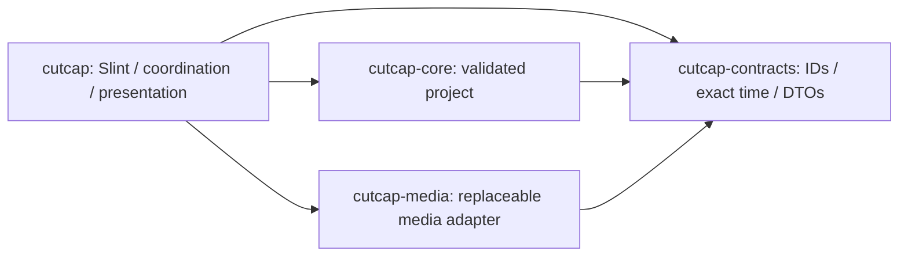

# CutCap architecture — Phase 1

## Workspace and ownership

Core remains independent of GUI, codecs, GPU, filesystem and threading. Contracts are a leaf. The app owns window lifecycle, project worker and media coordination. The media crate contains a functioning probe/decode adapter and tests; it imports no Slint/core types and never mutates Project. No codec DLL, webview or async runtime is linked. rfd 0.17.2 supplies the native asynchronous picker, parented using Slint's stable raw-window-handle-06 feature.

| Module | Responsibility |
|---|---|
| contracts/ids.rs, time.rs | Distinct non-nil UUID identities; exact source/project clocks; checked floor/ceil rescaling |
| contracts/media.rs, messages.rs | Validated metadata DTOs, commands, snapshots and errors; contract version 2 |
| core/project.rs | Schema 1 validated project graph and atomic mutations; unchanged in Phase 1 |
| media/backend.rs, probe.rs | MediaBackend contract, FFmpeg policy and bounded metadata parsing |
| media/process.rs, cancel.rs | Owned child processes, bounded pipe capture, timeout, cancellation and reaping |
| media/frame.rs, latest.rs | Validated opaque RGBA8; bounded latest-request/result mailbox |
| app/engine.rs, bridge.rs | Single project owner; reliable channels; metadata session cache/source selection |
| app/coordinator.rs, media_ui.rs | UI callbacks/models, native picker, probe completion and request correlation |
| app/preview.rs | UI-thread CPU buffer → Slint image adapter; presentation timing |
| app/benchmark.rs | Developer driver of the same real import/registration/preview path |
| app/gpu.rs | Optional independent DX12 enumeration; no compositor or texture sharing |

## Lifecycle and data flow

Main initializes tracing and the Slint winit/software window, then starts the cheap project worker and independent latest-frame decoder. NewProject installs two real empty tracks. A 33 ms UI timer drains at most eight reliable events, polls dialog/probe completion and takes at most one completed preview. Slint objects and weak-handle upgrades stay on the event-loop thread. VecModels update in place to preserve focus/repeater identity; project replacement explicitly restores workspace focus.

Import opens the native picker. One named probe thread canonicalizes/validates the local file, invokes FFprobe and returns metadata. The UI joins only after is_finished(), checks cancellation/ProjectId, then sends RegisterMedia to the project owner. The owner validates again, adds a genuine MediaAsset and retains metadata in its session cache. Only a successful snapshot adds a library entry and initiates its preview.

Source selection is independent of timeline Track/Clip selection. SelectMedia changes it through the owner. The UI immediately invalidates the old preview and waits for the matching snapshot. Relative whole milliseconds at the UI edge are converted with checked rational ceil rescaling into source ticks, then added to start PTS. The timeline playhead stays at zero. Every request carries PreviewTicket { project_id, media_id, request_id }.

One active decode, one replaceable pending request and one replaceable completed outcome bound the preview backlog. New seeks cancel active work; the decoder and presenter independently reject stale successes/errors. Owned frame buffers bypass reliable project channels. preview.rs calls public SharedPixelBuffer<Rgba8Pixel>::clone_from_slice and Image::from_rgba8 on the UI thread: one explicit full-frame copy, with possible additional renderer storage/copies. No zero-copy claim.

After the event loop, stop the timer, cancel/join media tasks, close reliable results before requests, then join the project worker. Cancelled children are killed/reaped before pipe readers are joined. Native dialog cancellation uses its own Cancel action; dropping rfd's future has no documented programmatic dialog-close guarantee.

## Domain and compatibility

Project schema remains 1: version, ID, name, rational timebase, tracks, source references and clips. Mutations validate before commit; deserialization validates a temporary complete graph. Unsupported versions/unknown fields, invalid names/IDs, duplicates, missing references, kind mismatches, invalid durations/endpoints, negative starts and same-track overlaps fail. Adjacent clips/cross-track overlap remain allowed. Core limits are 128 tracks, 10,000 references, 100,000 clips; the Phase 1 app additionally caps imported metadata at 128 assets. Post-deserialization limits alone are not a hostile-file sandbox; no project file loader exists.

No decoded buffers, native handles, metadata caches, selections or layout are serialized. A Video reference can have audio presence in session metadata; schema 1 does not model editable per-stream audio references. Persistence will require re-probing or explicit schema evolution. Contract version 2 adds registration/selection/media snapshot fields; it is an in-process protocol, not an independently shipped ABI.

Timeline ticks use the project clock (default 1/720000 s), never preview frame rate. SourceTime is signed, distinct and carries its own rational timebase. Rescaling uses checked i128 intermediates and explicit floor/ceil. VFR selection uses real PTS, never nominal frame-rate indexing.

## Media and presentation boundary

MediaBackend accepts path or DecodeRequest plus Cancellation and returns typed probe/frame results. Future libavcodec/libavformat or hardware implementations can replace FfmpegBackend without changing core or importing codecs into Slint. They must preserve cancellation, timestamp and buffer semantics.

The subprocess adapter is tested with external FFmpeg/FFprobe 9.0.1, invoked directly with argument arrays (Unicode/spaces tested), stdin null and no console. No executable is copied or bundled. The frame policy is **first original PTS at or after request**. One-second demux preroll with -copyts -noaccurate_seek -seek_timestamp 1 plus explicit PTS selection preserves nonzero starts. Automatic accurate-seek discard was disabled after the offset regression fixture exposed incorrect selection.

The first showinfo output supplies actual integer PTS and explicit filter timebase. A per-request unpredictable filter name/exact log prefix prevents media tags from impersonating timestamp records; a forged-title fixture tests this boundary. Missing PTS/no frame/invalid bytes fail explicitly. Requests after the last PTS may fail before nominal duration. CFR/VFR/offset fixtures establish tested behavior, not frame-accuracy guarantees for arbitrary codecs. Textual showinfo parsing is a compatibility risk requiring upgrade tests.

FFmpeg auto-orients quarter-turn matrices. DAR/SAR and rotation determine a square-pixel preview fit within 1280×720, without upscaling square-pixel sources. Rotated content and dimensions are tested. SDR converts through RGB24 to opaque RGBA8 (alpha discarded), top row first and packed width×4 stride. HDR/PQ/HLG/BT.2020, reflected matrices and non-quarter turns are rejected. Unknown SDR color metadata uses FFmpeg defaults; full color management and HDR grading are absent.

## Budgets

| Resource | Bound |
|---|---|
| Project request/result queues | 32 each; UI try_send and ≤8 events per 33 ms tick |
| Imports | One probe/picker, ≤128 registered metadata assets |
| Decode | One active, one pending, one completed outcome |
| Preview | ≤1280×720 RGBA8; ≤3,686,400 bytes/frame; exact stride/length/alpha |
| Input | Local nonempty regular file ≤32 GiB; path text ≤32,768 bytes |
| Source | Edges ≤4096, pixels ≤4096×2160, reported duration ≤24 h, ≤64 streams |
| Probe output/error | 1 MiB / 64 KiB; decode error output ≤1 MiB |
| Process | Probe 15 s / decode 20 s; 2 decoder threads, 1 filter/output thread; max single allocation 64 MiB |
| Inspection | 8 MiB probe input; 5 s analyzed media duration; file/pipe protocols |
| Diagnostics | ≤256 presentation samples; ≤128 probe timing records |

The old displayed image, incoming raw frame and new Slint copy can coexist (about three preview buffers, 11,059,200 bytes). Renderer caches and source/reference surfaces are additional. These budgets do not cap aggregate FFmpeg RSS or constitute an OS sandbox. File canonicalization/metadata calls run off UI but cannot be interrupted by the process timeout; pathological local filesystems, reparse/device paths and codec behavior need future hardening.

## UI and next rendering decision

Existing shell, tracks, splitters, zoom, scrolling, About/attribution and keyboard behavior remain. Import/source selection/seeking now work; library/inspector show real metadata, with estimated durations marked. Open/Save/Play/Export remain disabled. No playback clock, audio output, waveform or timeline editing exists.

Default timeline height is 210 logical px to give the viewer more room. Viewer aspect follows the oriented frame. Ctrl+I imports; existing Ctrl+N, Ctrl+0, zoom and clear-timeline-selection shortcuts remain. Window remains 1120×640, minimum 1000×600, initially at physical (32,16). Actual Windows/DPI evidence is in PHASE_1_REPORT.md.

wgpu 30.0.1 remains optional DX12 diagnostics. No unstable Slint interop is enabled. Phase 1 measurements assess request-based CPU presentation, ending at UI assignment, not physical scanout/playback pacing. Retain CPU presentation for the next transport experiment; investigate GPU interop against measured playback bottlenecks. Preview/export must eventually share timeline evaluation semantics, which do not exist yet.
