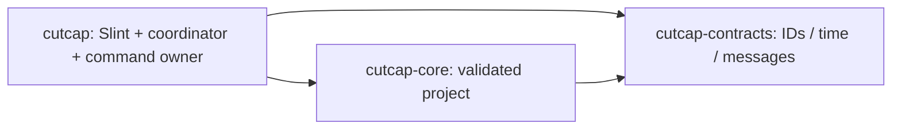

# CutCap architecture — Phase 0

## Implemented workspace

Contracts are a leaf and depend on Serde, UUID and thiserror. Core adds no GUI, media, GPU, threading runtime or I/O dependency. The app links Slint and tracing; its optional GPU diagnostic links wgpu/DX12 and pollster. There is no codec library, webview or async runtime. Cargo.lock resolves all dependencies including optional/other-platform packages; presence in the lockfile does not imply a component is linked into the default executable.

| Module | Responsibility |
|---|---|
| contracts/ids.rs | Distinct UUID-backed Project/Media/Track/Clip/Request identities, no nil IDs |
| contracts/time.rs | Rational timebase, signed project ticks, positive duration, distinct source PTS |
| contracts/messages.rs | Commands, snapshots, terminal events, selection and boundary errors |
| core/project.rs | Schema 1 model, validated deserialization, atomic track/media/clip insertion |
| app/main.rs | Logging, argument handling, backend/window lifecycle and orderly shutdown |
| app/engine.rs | Single project owner, scope validation and implemented command handling |
| app/bridge.rs | Two bounded standard-library channels and worker lifecycle |
| app/coordinator.rs | UI callbacks, request correlation, bounded event drain and Slint view models |
| app/preview.rs | Replaceable Slint preview presentation adapter, currently availability text only |
| app/gpu.rs | Optional independent DX12 adapter enumeration; no device, texture or compositor |
| app/ui | Tokens, view DTO, small reusable controls and editor panels |

## Lifecycle and flow

The process configures tracing, checks CLI arguments, selects winit/software using Slint's public BackendSelector, constructs the window on the main thread, initializes the preview adapter and starts one named command worker. The coordinator submits NewProject; the worker creates a valid in-memory project with two real empty tracks. A 33 ms Slint timer drains at most eight events per callback. Every accepted command returns a complete small snapshot or a typed failure. The timer converts snapshots to `TrackRow` models and updates the inspector/status on the UI thread.

There is no shared mutable Project. GUI callbacks use `try_send`, never wait. The worker may block on its bounded result channel, providing backpressure. It runs only short model operations; media work must not be added to this loop. On window close, the timer stops, the event receiver is dropped (unblocking a full result channel), the command sender is closed, and the worker is joined after the event loop returns. Pending operations are abandoned during teardown; they are not reported as successes. No worker owns a Slint handle.

The app keeps a small snapshot copy and updates an existing VecModel in place on successful commands. Preserving repeater item identity keeps keyboard focus alive after selection changes; replacing the whole model destroys focused track buttons. Project replacement explicitly restores workspace focus after any old rows are removed. With at most 128 tracks and no frame traffic these coarse snapshots are an intentional simple choice; high-frequency playback must use a separate presentation path.

## Domain model and schema

Project stores schema version, stable ID, name, timebase, tracks, media references and clips. Private collections expose read-only slices; mutations validate before commit. `Project` deserialization constructs a temporary DTO, then validates the full graph. Schema 1 rejects unsupported versions/unknown fields, duplicates, empty paths, invalid names, missing references, media/track kind mismatches, negative timeline starts, overflow and same-track overlap. Adjacent clips are valid. Cross-track overlap is allowed. A media reference has one Video/Audio kind in this deliberately small schema; demuxed assets with multiple streams need an explicit schema evolution.

Limits are 128 tracks, 10,000 media references and 100,000 clips. These are guardrails, not performance guarantees. Serde validation runs after allocation: a future file loader must first bound file bytes and parsing resource use. No file loader or project persistence exists yet. No migration is implemented; future versions fail explicitly. Selection belongs to the engine session and layout/zoom to the UI, outside serialized Project.

Timeline ticks use the project's rational seconds-per-tick timebase, default 1/720000 s. This represents common integer and NTSC fractional video rates exactly without binding the engine to the viewer rate. Arbitrary source clocks and rates remain distinct. `SourceTime` carries its own timebase and permits negative PTS. There is no implicit timebase conversion, nominal-rate indexing, media-duration check, speed mapping or VFR frame mapping yet. Those need verified metadata and explicit rounding policies in the next milestone.

## Presentation and media boundary

The software Slint renderer draws only UI. `preview.rs` is the replaceable presentation module; the coordinator does not set preview pixels or interpret media. The viewer contains honest unavailable text. A frame/texture trait is deliberately deferred until there is a real frame producer; no empty generic renderer hierarchy is needed for two labels.

Phase 1 will introduce an owned CPU frame descriptor (size, checked stride/bytes, color information, source PTS and request generation), a latest-frame mailbox with a byte budget and a UI-thread Slint image adapter behind this module. Decode workers cannot send every decoded frame into the reliable command-result queue. A measured GPU experiment may replace presentation with a texture route while preserving the project, command and timestamp semantics. Never put a `wgpu::Texture`, Slint Image or FFmpeg pointer in core or serialized contracts.

wgpu 30.0.1 is isolated behind `gpu-diagnostics`. It targets only DX12 and enumerates adapters without opening the UI. The default shell needs no GPU. Slint's available wgpu/winit integrations include unstable versioned APIs; none are enabled. Any adoption requires an ADR, pinned compatibility, device-loss/fallback behavior and measured copy cost, latency, memory and pacing on the integrated GPU. [Slint renderer documentation](https://docs.slint.dev/latest/docs/slint/guide/backends-and-renderers/backend_winit/) and [BackendSelector API](https://docs.slint.dev/latest/docs/rust/slint/struct.BackendSelector) were reviewed at kickoff.

FFmpeg is the intended media infrastructure but is not linked or invoked by CutCap in Phase 0. The installed CLI is a GPL-enabled Gyan build, useful for development inspection only. A controlled LGPL-compatible runtime and an adapter with timeouts, explicit stream metadata, safe ownership and bounded allocations are prerequisites to distribution. Preview and export will share timeline evaluation semantics when implemented; they will have different execution/presentation policies.

## UI foundation

The native window uses Segoe UI, logical pixels, a 16:9 placeholder viewer, media/inspector panels, a 60-second empty ruler, fixed zero playhead and real empty tracks. The ruler is a view range, not media duration. Zoom scales ruler spacing, not engine ticks. Timeline content scrolls horizontally and vertically; headers scroll with it in Phase 0. Three splitters resize panels with clamped sizes, also operable by arrow keys. Ctrl+0 resets layout/zoom. Track creation/selection and New Project use the worker contract. Save/Open/Import/Play/Step/Export are disabled. The About popup includes the built-in AboutSlint attribution widget.

The initial window is 1120×640 logical pixels, minimum 1000×600. It opens at physical position (32,16) near the primary display's origin so OS cascading does not place the large editor below the work area on the tested scaled laptop display. Saved/per-monitor placement is deferred. Native maximize, restore and resizing are provided by Windows/winit. Accessibility is enabled with named buttons and explicit disabled states; this is not a full assistive-technology audit. Global shortcuts use Slint's logical-key KeyBinding API rather than raw text comparisons. See PHASE_0_REPORT.md for actual launch/interaction evidence and untested DPI combinations.
