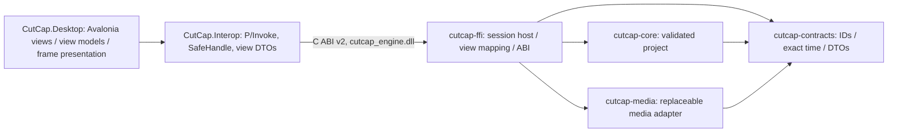

# CutCap architecture — Avalonia frontend over the Rust engine

Since the Avalonia migration (docs/AVALONIA_MIGRATION_REPORT.md) the frontend is C#/.NET 10 + Avalonia 12; Rust keeps editing semantics, media processing, project state and all time arithmetic. Phase 2 adds source playback and ABI 2 (PHASE_2_PLAYBACK_CONTRACT.md). Production playback-button bindings remain a frontend handoff; the owner approved only an opt-in render diagnostics hook. The Slint frontend is retired; its last version is commit a3de692 on `claude/phase-2a-ui`.

## Workspace and ownership

Core remains independent of GUI, codecs, GPU, filesystem and threading. Contracts are a leaf. `cutcap-ffi` owns the session (command worker, media host), derives display DTOs and is the only crate with `unsafe` (isolated in `abi.rs`). The .NET side holds no project state: every displayed value comes from the latest engine view, and every action is an engine call.

| Module | Responsibility |
|---|---|
| contracts/ids.rs, time.rs | Distinct non-nil UUID identities; exact source/project clocks; checked floor/ceil rescaling |
| contracts/media.rs, messages.rs | Validated metadata DTOs, commands, snapshots and errors; contract version 2 |
| core/project.rs | Schema 1 validated project graph and atomic mutations |
| media/backend.rs, probe.rs | MediaBackend contract, FFmpeg policy and bounded metadata parsing |
| media/process.rs, cancel.rs | Owned child processes, bounded pipe capture, timeout, cancellation and reaping |
| media/frame.rs, latest.rs | Validated opaque RGBA8; bounded latest-request/result mailbox |
| media/stream.rs, persistent.rs, clock.rs | Framed persistent decode, three-frame queue, latest epoch/reset and monotonic clock |
| ffi/playback.rs | Source transport, two-frame lookahead, due/drop/buffering/EOF and copied-position accounting |
| ffi/engine.rs, bridge.rs | Single project owner; reliable bounded channels (moved unchanged from the Slint app) |
| ffi/media.rs | Probe job, latest decoder, ticket-gated presentation, latest frame (ported from media_ui/preview) |
| ffi/session.rs | Request bookkeeping and pump (ported from the Slint coordinator) |
| ffi/view.rs | View DTOs and exact-time formatting; tested source-time grammar |
| ffi/abi.rs | Versioned C ABI: handle registry, panic barrier, buffer validation (docs/NATIVE_ABI.md) |
| ffi/bin/gpu_info.rs | Optional DX12 adapter enumeration (`--features gpu-diagnostics`) |
| Interop/EngineSession.cs | Managed owner: ABI check, typed calls, view reads, frame copy into caller memory |
| Desktop/Services/EngineHost.cs | UI-thread pump timer, view/frame notifications, command rejection → status |
| Desktop/ViewModels | MVVM over the view; in-place list sync preserves item identity and focus |
| Desktop/Controls | IconView, FrameView (bitmap presenter), TimelineScale/Ruler/Lanes (custom-drawn) |

## Lifecycle and data flow

App creates EngineHost, the main window and its view models, then starts the session: cutcap_session_create verifies ABI 2, starts command/isolated/persistent workers and queues NewProject (two real empty tracks). A 16 ms UI timer drains at most eight reliable events, polls probe/frame work and selects at most one offered frame from bounded lookahead, then reads the view when changed. Decode, process I/O and waits stay off pump. Frame copying records delivery, not scanout. See PHASE_2_PLAYBACK_CONTRACT.md for clock/state/framing and PHASE_2_PLAYBACK_REPORT.md for measurements and pending visual bindings.

Import opens Avalonia's native, window-parented, asynchronous picker (`StorageProvider`). The chosen path crosses the ABI as UTF-16. One probe thread canonicalizes and validates the file and invokes FFprobe; the session commits `RegisterMedia` through the project owner, which validates again. Only a successful snapshot adds a library entry and starts its preview.

Source selection is independent of timeline Track/Clip selection. Relative whole milliseconds are converted in Rust with checked rational ceil rescaling into source ticks, then added to start PTS. The timeline playhead stays at zero. Every request carries `PreviewTicket { project_id, media_id, request_id }`. One active decode, one replaceable pending request and one replaceable outcome bound the backlog; the decoder and the session's presentation gate independently reject stale successes and errors.

Frame presentation: the session keeps the latest validated RGBA8 frame with a generation number. `FrameView` asks for the frame info and has the engine copy the pixels once, row by row, straight into a reused `WriteableBitmap` (RGBA8888, opaque, no conversion), then invalidates itself. Frames never pass through view-model property notifications. One full-frame copy per presentation; Avalonia's compositor may upload/copy further. No zero-copy claim.

Shutdown: after the window closes, the pump timer stops and the session is disposed; destroy cancels the probe and decoder (killing and reaping FFmpeg children), drops reliable results before requests and joins the command worker. Measured ~0.1 s, including during an active decode.

## Domain and compatibility

Project schema remains 1: version, ID, name, rational timebase, tracks, source references and clips. Mutations validate before commit; deserialization validates a temporary complete graph. Unsupported versions/unknown fields, invalid names/IDs, duplicates, missing references, kind mismatches, invalid durations/endpoints, negative starts and same-track overlaps fail. Adjacent clips/cross-track overlap remain allowed. Core limits are 128 tracks, 10,000 references, 100,000 clips; the Phase 1 app additionally caps imported metadata at 128 assets. Post-deserialization limits alone are not a hostile-file sandbox; no project file loader exists.

No decoded buffers, native handles, metadata caches, selections or layout are serialized. A Video reference can have audio presence in session metadata; schema 1 does not model editable per-stream audio references. Persistence will require re-probing or explicit schema evolution. Contract version 2 adds registration/selection/media snapshot fields; it is an in-process protocol, not an independently shipped ABI.

Timeline ticks use the project clock (default 1/720000 s), never preview frame rate. SourceTime is signed, distinct and carries its own rational timebase. Rescaling uses checked i128 intermediates and explicit floor/ceil. VFR selection uses real PTS, never nominal frame-rate indexing.

## Media and presentation boundary

MediaBackend accepts path or DecodeRequest plus Cancellation and returns typed probe/frame results. Future libavcodec/libavformat or hardware implementations can replace FfmpegBackend without changing core or importing codecs into the frontend. They must preserve cancellation, timestamp and buffer semantics.

The subprocess adapter is tested with external FFmpeg/FFprobe 9.0.1, invoked directly with argument arrays (Unicode/spaces tested), stdin null and no console. No executable is copied or bundled. The frame policy is **first original PTS at or after request**. One-second demux preroll with -copyts -noaccurate_seek -seek_timestamp 1 plus explicit PTS selection preserves nonzero starts. Automatic accurate-seek discard was disabled after the offset regression fixture exposed incorrect selection.

The first showinfo output supplies actual integer PTS and explicit filter timebase. A per-request unpredictable filter name/exact log prefix prevents media tags from impersonating timestamp records; a forged-title fixture tests this boundary. Missing PTS/no frame/invalid bytes fail explicitly. Requests after the last PTS may fail before nominal duration. CFR/VFR/offset fixtures establish tested behavior, not frame-accuracy guarantees for arbitrary codecs. Textual showinfo parsing is a compatibility risk requiring upgrade tests.

FFmpeg auto-orients quarter-turn matrices. DAR/SAR and rotation determine a square-pixel preview fit within 1280×720, without upscaling square-pixel sources. Rotated content and dimensions are tested. SDR converts through RGB24 to opaque RGBA8 (alpha discarded), top row first and packed width×4 stride. HDR/PQ/HLG/BT.2020, reflected matrices and non-quarter turns are rejected. Unknown SDR color metadata uses FFmpeg defaults; full color management and HDR grading are absent.

## Budgets

| Resource | Bound |
|---|---|
| Project request/result queues | 32 each; non-blocking submit and ≤8 events per 16 ms pump |
| Imports | One probe/picker, ≤128 registered metadata assets |
| Decode | One active, one pending, one completed outcome |
| Preview | ≤1280×720 RGBA8; ≤3,686,400 bytes/frame; exact stride/length/alpha |
| Input | Local nonempty regular file ≤32 GiB; path text ≤32,768 bytes |
| Source | Edges ≤4096, pixels ≤4096×2160, reported duration ≤24 h, ≤64 streams |
| Probe output/error | 1 MiB / 64 KiB; decode error output ≤1 MiB |
| Process | Probe 15 s / decode 20 s; 2 decoder threads, 1 filter/output thread; max single allocation 64 MiB |
| Inspection | 8 MiB probe input; 5 s analyzed media duration; file/pipe protocols |
| Diagnostics | ≤256 presentation samples; ≤128 probe timing records |

The previous session frame, an incoming decoded frame and the frontend bitmap can coexist (about three preview buffers, 11,059,200 bytes). Renderer caches and source/reference surfaces are additional. These budgets do not cap aggregate FFmpeg RSS or constitute an OS sandbox. File canonicalization/metadata calls run off UI but cannot be interrupted by the process timeout; pathological local filesystems, reparse/device paths and codec behavior need future hardening.

## UI and next rendering decision

The Avalonia shell (DESIGN.md) has a custom title bar over Avalonia-drawn Windows caption buttons, an asset workspace with category tabs, a player, a context inspector and a full-width timeline. Panels resize with grid splitters and proportional columns with minimums (window minimum 960×600). Responsive rules use Avalonia container queries. Unsupported systems (Audio/Text/Stickers/Effects/Transitions/Filters/Adjustment, clip inspector tabs, Timeline preview, Play, Undo/Redo, Split/Delete, Export, track visibility/mute/lock) are visible with honest states or disabled with tooltips.

The timeline ruler and lanes are custom-drawn controls that draw only the viewport; `TimelineScale` keeps time ↔ pixel conversion independent of rendering and is unit-tested. Track headers are a list with keyboard selection through the engine. There are no clips yet; a future clip surface belongs in the lanes control, not one control per clip.

wgpu 30.0.1 remains an optional DX12 diagnostic. The CPU frame path is measured (docs/measurements, AVALONIA_MIGRATION_REPORT.md). GPU interop with Avalonia's compositor is deliberately not attempted until playback measurements show the CPU path is the bottleneck; any experiment must keep the CPU fallback.
