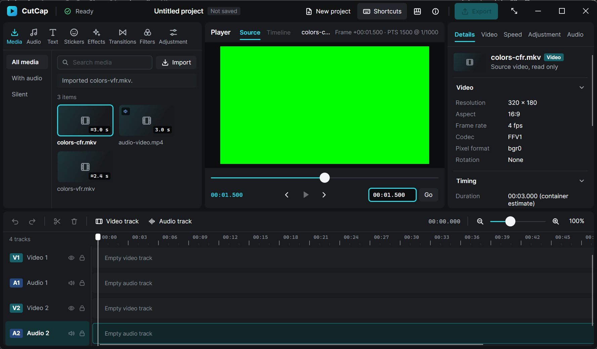

# Avalonia migration report

Date: 2026-11-04. Branch `migration/avalonia-ui`, cut from the Slint baseline commit `a3de692` (`claude/phase-2a-ui`). Implemented by Claude Opus 5.5 at the owner's direction. Windows 11 x64, Core Ultra 7 255H, integrated Arc, 16 GB, 1920×1200 at 150 % scaling.



## 1. Executive summary

CutCap's frontend is now Avalonia 12.1.5 on .NET 10 over the unchanged Rust engine, connected by a small, versioned C ABI (`cutcap_engine.dll`, ABI 1). All verified Phase 1 behavior was re-exercised through the new stack in the running Windows app and in automated tests:
- real import and metadata;
- decoded frames and source seeking, including the VFR ceiling policy;
- cancellation and stale-result rejection;
- corrupt-file errors;
- project and track creation and selection;
- keyboard shortcuts;
- clean shutdown with FFmpeg children reaped.

The Slint frontend was removed after those checks and remains in history. The interface follows the compact editor layout of the owner's reference with an original charcoal-and-cyan identity and no purple. `verify.ps1` (Rust and .NET, including a win-x64 publish) passes. The main costs are memory and startup: about 220–330 MB working set against Slint's 35–85 MB, and 0.6–1.2 s to a visible window against about 0.13 s. Seek latency is unchanged, because decoding dominates it, and frame copies are 3–5× cheaper.

## 2. Repository structure

```text
CutCap.slnx, global.json (SDK 10.0.401), Directory.Build.props, Directory.Packages.props
apps/CutCap.Desktop/        Avalonia app (App, Program, Views, ViewModels, Controls, Services, Themes, Assets)
src-dotnet/CutCap.Interop/  NativeMethods (LibraryImport), SessionSafeHandle, EngineSession, view DTOs
crates/cutcap-contracts/    unchanged
crates/cutcap-core/         unchanged
crates/cutcap-media/        unchanged
crates/cutcap-ffi/          engine.rs, bridge.rs (moved), media.rs, session.rs, view.rs, abi.rs, tests.rs, bin/gpu_info.rs
tests/CutCap.Interop.Tests/ tests/CutCap.Desktop.Tests/  tests/fixtures (unchanged)  tests/ui_smoke.md
scripts/verify.ps1, scripts/generate-icons.py, scripts/native-ui/ (ui.ps1, find.ps1, bench.ps1)
```

## 3. Architecture and dependency graph

`CutCap.Desktop → CutCap.Interop → (C ABI) cutcap-ffi → {cutcap-core, cutcap-media} → cutcap-contracts`. C# owns presentation and interaction. Rust owns:
- project state and editing semantics;
- media work;
- all time arithmetic and formatting of time values.

The desktop app keeps no project state. Every value it shows comes from the latest engine view, and every action is an engine call. See ARCHITECTURE.md and DECISIONS.md ADR 012–016.

## 4. C#–Rust ABI design

docs/NATIVE_ABI.md is the specification. In summary:
- **Interface:** `extern "C"` functions with explicit pointer-and-length strings. Text is UTF-8; paths are UTF-16, so Unicode and long paths round-trip.
- **Results:** integer status codes, with the message available from a per-thread last-error slot.
- **Frames:** described by a 24-byte `#[repr(C)]` struct.
- **Data flow is pull-based.** A 16 ms UI timer calls `pump`, which only polls and never waits. The frontend then reads a coalesced JSON view, only when it changed, and copies frames by generation number. There are no callbacks.
- **Versioning:** ABI 1. Contract version 2 and project schema 1 are unchanged.

## 5. Ownership and lifetime rules

- **Sessions are registry keys, not pointers.** Stale, forged or double-destroyed handles return `INVALID_HANDLE`. .NET's `SessionSafeHandle` ref-counting keeps a session alive across in-flight calls.
- **Caller buffers are only borrowed** for the duration of a call, and are validated first: null, alignment, length and stride.
- **Rust owns frames.** .NET copies them out and never holds a Rust pointer.
- **Panics are caught at every export.** A panic poisons only its own session.
- **Shutdown order:** after the window closes, the timer stops and the session is disposed. Disposal cancels the probe and decoder, kills and reaps children, then closes results before requests and joins the workers, as in Phase 1. Measured at about 110 ms, including during an active decode.

## 6. UI components implemented

- **Shell:** title bar (mark, status, project, actions, disabled Export, Windows caption buttons) and the shortcuts and About flyouts.
- **Asset workspace:**
  - category tabs: Media, Audio, Text, Stickers, Effects, Transitions, Filters, Adjustment;
  - media collections, name search, an Import call to action and a tile grid with real durations and audio badges;
  - honest "coming later" states for the other categories.
- **Player:** Source and Timeline tabs (Timeline disabled), source name and actual-frame caption, a fitted `FrameView`, scrubber, timecodes, transport with Play disabled, and a go-to field.
- **Inspector:** Details, Video, Speed, Adjustment and Audio tabs. Details shows identity plus collapsible metadata sections; the clip tabs explain they need a clip.
- **Timeline:** disabled Undo, Redo, Split and Delete; Video track and Audio track buttons; playhead time; zoom controls. Track headers sit beside a custom-drawn, viewport-aware ruler and lanes.
- **Reusable controls:** `IconView` (47 generated icons), `FrameView`, `TimelineScale` / `TimelineRuler` / `TimelineLanes`.
- **Control themes:** tool, filled and primary buttons; category, view and nav tabs; media tile; track header; section toggle.

## 7. Visual design decisions

DESIGN.md records the tokens:
- **Surfaces:** ground #111315, panels #191B1E, raised #22252A.
- **Accent:** cyan #22D9E6, hover #50E6EE.
- **Track families:** teal for video, blue for audio.

Other decisions:
- **Type:** Inter, bundled under OFL 1.1, at compact 11–13 px sizes, with a monospace face only for time.
- **Shapes:** flat panels with 8 px radii and 6 px gutters, and shadows only on flyouts.
- **Fluent overrides:** Fluent's accent and input brushes are overridden, so nothing defaults to another hue.
- **Window caption:** Avalonia 12 draws the Windows caption itself. Its title text is hidden with an app-level style on `PART_TitleTextPanel`; the full-screen, minimize, maximize and close buttons stay.
- **Layout:** proportional columns and container queries keep the layout usable down to the 960×600 minimum.
- **Branding:** the mark is original, a cyan tile with a play glyph. No CapCut branding or assets are used.

## 8. Preserved Phase 1 capabilities

All of these ran through the new stack:
- native picker (Avalonia StorageProvider);
- bounded FFprobe probe;
- registration by the project owner only;
- real metadata;
- latest-only frame decoding;
- ticket-gated presentation;
- ceiling-PTS seeks with exact rational rescaling;
- VFR real timestamps;
- cancellation and stale rejection;
- typed errors;
- 128-asset, 32-queue and 1280×720 budgets;
- process ownership and reaping;
- two default tracks per project;
- track add and select;
- keyboard shortcuts.

The engine, bridge and source-time grammar moved with their tests. The media and preview coordination moved without UI types.

## 9. Functional parity matrix

| # | Behavior | Evidence |
|---|---|---|
| 1 | Native file selection | Native runs: Ctrl+I opened the parented picker and returned the chosen path, for 3 and then 5 imports |
| 2 | Real media probing | colors-cfr 320×180 FFV1 4 fps, audio-video 320×180 H.264 12 fps with audio, colors-vfr 160×90 FFV1 10 fps (UIA tree, interop test) |
| 3 | Project media registration | Library and inspector show only engine-registered assets; duplicate and stale cases covered by moved engine tests |
| 4 | Metadata display | Inspector Video, Timing and File sections (screenshots) |
| 5 | Frame decoding | Red first frame (interop pixel check); green at PTS 1500 natively |
| 6 | Source seeking | Go-to 1500; scrubber Home then Right ×3 requested 300 ms and showed PTS 500 (native) |
| 7 | VFR policy | Interop test: 201 ms → PTS 700 @ 1/1000 (real DLL and FFmpeg) |
| 8 | Cancellation | Rust session test (superseded seeks), interop rapid seeks, dispose during probe/decode |
| 9 | Stale-result rejection | Frame generation checks; only the last of four rapid seeks presented (Rust and .NET) |
| 10 | Missing/corrupt errors | Native corrupt.mp4 (message, no tile); interop corrupt and missing |
| 11 | Project creation | Native Ctrl+N cleared the library and preview; interop and Rust new-project tests |
| 12 | Track creation | Native Video/Audio track buttons (V2/A2 badges) |
| 13 | Track selection | Native click; Down moved to Audio 1 through the engine |
| 14 | Keyboard navigation | Ctrl+Plus ×2 → 150 % straight after a track click; Ctrl+0; scrubber keys; Enter in go-to |
| 15 | Clean shutdown | Close during an active decode exited in 108 ms with code 0 and no CutCap/FFmpeg/FFprobe processes left; every benchmark run exited 0 |

No Phase 2 playback existed in the baseline, so none had to be preserved.

## 10. Removed Slint components and dependencies

- **Removed:** `apps/cutcap` (Slint UI, `build.rs`, coordinator, media_ui, preview, presentation, benchmark CLI, gpu module), workspace dependencies `slint`, `slint-build` and `rfd`, and `scripts/measure-preview.ps1`, which drove the removed `--benchmark-preview` CLI. The lockfile shrank by about 5,250 lines.
- **Moved:** the DX12 probe is now `cargo run -p cutcap-ffi --features gpu-diagnostics --bin cutcap-gpu-info`.
- **Updated:** CI, `verify.ps1`, AGENTS.md, CLAUDE.md, README, ARCHITECTURE, ENGINE_UI_CONTRACT, DECISIONS, ROADMAP, SETUP_WINDOWS, LICENSE_REVIEW, MODEL_RESPONSIBILITIES, DEVELOPMENT_RULES, DESIGN.md and ui_smoke.md.
- **Retained as history:** the Phase 0, 1 and 2A reports.

## 11. Tests executed

| Command | Result |
|---|---|
| `./scripts/verify.ps1` | Exit 0, all 9 stages: fmt, clippy `-D warnings`, cargo test, debug build, release build, dotnet build Debug, dotnet test, dotnet build Release, self-contained publish. Evidence in `.artifacts/verification` |
| `cargo test --workspace` | 45 passed (contracts 6, core 6, media 11, cutcap-ffi 22), 6 ignored (FFmpeg-only) |
| `cargo test -p cutcap-media --test ffmpeg_integration -- --ignored --test-threads=1` | 5 of 5 passed |
| `cargo clippy -p cutcap-ffi --all-targets --all-features -- -D warnings` | Clean, including the DX12 binary |
| `dotnet test CutCap.slnx` | 24 passed: interop 15 (real DLL, real FFmpeg) and desktop 9; 0 skipped on this machine |

**Interop coverage:**
- ABI version match and mismatch;
- forged and zero handles;
- double dispose and raw double destroy;
- use after dispose;
- error status and message propagation;
- invalid UUID and track kind;
- engine rejections surfaced as view status;
- project, track and selection state;
- real metadata and first-frame pixels;
- Unicode paths (CJK, Cyrillic, emoji) with the folder shown without the `\\?\` prefix;
- malformed destinations (too small, narrow stride, negative length);
- padded strides with untouched padding;
- rapid seeks and stale generations;
- VFR;
- corrupt and missing files;
- dispose during activity with child-process counts.

The Rust ABI tests cover the same boundary without FFmpeg. The desktop tests cover timeline coordinates and zoom clamping, ruler label spacing at every zoom, the visible-range-only ruler, list identity under reorder, timecode notation and icon data.

## 12. Windows GUI verification

All runs used the real app at 1920×1200 and 150 % scaling, the Debug build and later the published Release build, driven by real mouse and keyboard input. Input went only to CutCap's own window; the harness aborts if any other window takes the foreground.

Exercised:
- empty state;
- three imports with picker completion;
- adding tracks;
- tile selection and the inspector;
- go-to seek;
- With audio filter, All media, name search;
- track selection by click and by Down;
- zoom shortcuts;
- scrubber keys;
- the Effects state and the Speed placeholder;
- Shortcuts flyout and Escape;
- New project;
- corrupt import;
- close during decode.

Also checked:
- window sizes of 1800×1050 outer, the 960×600 minimum and 1880×1150;
- the UI Automation tree: every control has a name and disabled controls report as disabled.

Bugs found and fixed during testing:
- drawn title text overlapping the title bar;
- icon subpaths with stray strokes;
- the status line stuck on "1 pending";
- player header overlap;
- inspector tabs hidden at narrow widths;
- inspector clipping at the minimum size.

Screenshots: `docs/images/avalonia-empty.jpg`, `-source`, `-search`, `-track`, `-unavailable`, `-shortcuts`, `-corrupt` (taken before the last cosmetic fixes) and `-minimum`.

**Not exercised natively:**
- dialog Cancel, the Cancel-import button and the Cancel-preview button (covered by engine and interop tests);
- splitter dragging and keyboard resizing;
- maximize, snap and multi-monitor;
- Tab-order traversal;
- 100 % or 200 % scaling;
- a screen reader;
- rotated media in the UI;
- long sessions.

## 13. Measured performance

Data and method are in `docs/measurements/avalonia-migration.json`, produced by `scripts/native-ui/bench.ps1`. Both builds were release, run three times each with the same 1080p H.264 clip and the same seek script.

| Metric | Slint (a3de692) | Avalonia (Release, self-contained) |
|---|---|---|
| Process start → window visible | 114–152 ms (first cold run 678) | 1,011–1,200 ms; with ReadyToRun 570–889 ms |
| Working set at idle start | 34.5 MB | 264 MB; with ReadyToRun 222 MB |
| Working set / private after import and 5 seeks | 85 / 29 MB | 318–330 / 198–210 MB |
| Peak working set | 92 MB | 339–351 MB |
| Seek → frame in UI image (1080p → 1280×720) | 168–241 ms | 160–242 ms |
| Of which FFmpeg decode | 107–216 ms | 109–216 ms |
| Frame copy into the UI image | 1.0–2.4 ms | 0.28–0.40 ms (first frame ~1 ms) |
| Import → first frame | not logged by that build | 294–382 ms |
| Idle CPU (5 s, all cores) | 0–0.1 % | 0.16–0.35 % (16 ms pump) |
| Close → exit | 48–65 ms, exit 0 | 112–119 ms, exit 0 |
| FFmpeg/FFprobe left after exit | 0 | 0 |

Interpretation:
- **Latency:** unchanged. Subprocess decoding dominates it, and the copy path is cheaper because the engine writes straight into the locked bitmap.
- **Memory and startup:** substantially worse, from the .NET runtime, Skia, ANGLE and Avalonia's compositor. ReadyToRun recovers part of the startup cost.
- **Native Rust library memory:** could not be separated from the process total. Its frame buffers are bounded at three 3.5 MiB frames.

Avalonia is not claimed to be faster overall.

## 14. Release publishing status

`dotnet publish apps/CutCap.Desktop -c Release -r win-x64 --self-contained true` succeeds (also run by `verify.ps1`). The output has 228 files, 222 MB with ReadyToRun on, including `cutcap_engine.dll`, and the published app was launched and exercised.

- **Single-file:** not used.
- **Native AOT:** not enabled. The publish stopped at NuGet audit error NU1903, advisory GHSA-p3jp-9v83-76w9 (high) on `Microsoft.DotNet.ILCompiler` 10.0.12 from SDK 10.0.401. The advisory was not suppressed, so AOT was not run.
- **Not done:** no installer, no signing and no upload.
- **Size:** Avalonia.Desktop also ships unused X11, macOS and FreeDesktop assemblies; a Win32-only package set would shrink the output.

## 15. Licensing and distribution status

LICENSE_REVIEW.md has the inventory. Avalonia, SkiaSharp, HarfBuzzSharp, CommunityToolkit.Mvvm and .NET are MIT; ANGLE and Skia are BSD-3-Clause; the Inter font is OFL 1.1 and is bundled; the test packages are Apache-2.0 and MIT. The Slint royalty-free attribution route no longer applies to current builds.

FFmpeg remains an external development dependency, GPL, and is not bundled. A distribution still needs a complete notice bundle and the owner's choice of application license. The About flyout names Avalonia, Inter and the separately installed FFmpeg.

## 16. Known limitations

- **Memory and startup** are higher than with Slint (section 13).
- **Category tabs** wrap at the minimum width.
- **Tiles** show a placeholder, not a thumbnail; poster frames need an engine API.
- **Library filter and search** reset with each project.
- **Disabled:** playback, timeline clips, undo/redo, persistence, export and track toggles.
- **Timeline playhead** stays fixed at 0.
- **Inspector tabs other than Details** are placeholders.
- **Accessibility** was checked through the UI Automation tree only.
- **Scaling** was tested only at 150 %.
- **Window decorations** depend on Avalonia's drawn-decoration template; the style that hides the title text targets the `PART_TitleTextPanel` template part and must be re-checked on Avalonia upgrades.
- **CI** has not been run remotely; `actions/setup-dotnet@v5` is configured but unverified.

## 17. Recommended next milestone

Phase 2's persistent source transport (ROADMAP milestone 2):
- a bounded persistent decoder with real frame durations and a playback clock in Rust;
- a pull-based, generation-tagged frame queue in the ABI (ABI 2), so Play can be enabled without per-frame JSON;
- poster frames for library tiles.

In parallel, frontend packaging work: a Win32-only Avalonia package set, a re-test of Native AOT after an SDK update, and measuring Avalonia's software versus GPU compositor on the integrated GPU.

## 18. Handoff for GPT-6.1 Sol

- **What stays yours, unchanged:** core, contracts, media and the Phase 1 engine/bridge, now in `crates/cutcap-ffi/src/{engine,bridge}.rs` with their tests.
- **Where the UI glue went:** the Slint glue became `media.rs` (probe job, latest decoder, presentation gate, latest frame) and `session.rs` (request bookkeeping and pump). Both are frontend-independent and tested with a controlled backend in `tests.rs`.
- **New engine features:** expose new state by adding fields to `view.rs` DTOs. That is compatible, since the frontend ignores unknown fields. New actions need a `Session` method plus an export in `abi.rs`: validate inputs, wrap the body in `guard`, never block, and add Rust and .NET tests. Bump `ABI_VERSION` and `NativeMethods.AbiVersion` for any breaking change and document it in NATIVE_ABI.md.
- **Formatting and frames:** keep formatting of time values in Rust (`view.rs`). For playback, add a frame queue next to `PresentedFrame` rather than widening the JSON view.
- **Running and testing:** `dotnet run --project apps/CutCap.Desktop` builds the DLL. `./scripts/verify.ps1` runs everything, and `scripts/native-ui/bench.ps1` measures against the published build.
- **Ownership:** the frontend (`apps/CutCap.Desktop`, `src-dotnet`) is the UI side's. The ABI files are shared and need both owners.
