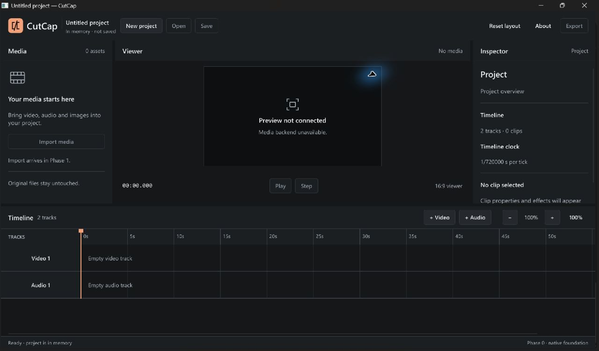

# Phase 0 — implementation and verification report

Date: 2026-10-30, Asia/Singapore. Implementer: GPT-6.1 Sol, sole developer for this phase. Initial repository: empty Git repository, no existing source or commits. Work branch: `codex/phase-0`.

## A. Implementation summary

Built a native Windows Rust/Slint application, a three-crate Cargo workspace, a validated non-destructive project model, typed commands/results, a bounded command worker, Windows CI and permanent engineering documentation. This is a functioning foundation with real empty tracks and model/UI round trips. It does not decode, play, save or export media.

The release executable is `target/release/cutcap.exe` (15,226,880 bytes on this workstation). SHA-256 of the validated local executable:

```text
8A2B6684C561EDB382E3FEE8E26863147803C4707F5F8FBA05DF7E2B2BC962FE
```

This identifies the local artifact; it is not a claim of bit-for-bit reproducibility across SDKs or machines. Build artifacts and raw local evidence stay ignored in `target/` and `.artifacts/`.



## B. Actual repository structure

Generated/ignored build output and Git internals are omitted. The source tree contains no empty placeholder crates or directories.

```text
CutCap/
├── .cargo/config.toml
├── .editorconfig
├── .gitattributes
├── .github/workflows/windows.yml
├── .gitignore
├── AGENTS.md
├── CLAUDE.md
├── Cargo.lock
├── Cargo.toml
├── DESIGN.md
├── PRODUCT.md
├── README.md
├── rust-toolchain.toml
├── apps/cutcap/
│   ├── Cargo.toml
│   ├── build.rs
│   ├── src/
│   │   ├── bridge.rs
│   │   ├── coordinator.rs
│   │   ├── engine.rs
│   │   ├── gpu.rs
│   │   ├── main.rs
│   │   └── preview.rs
│   └── ui/
│       ├── app-window.slint
│       ├── models.slint
│       ├── theme.slint
│       ├── assets/
│       │   ├── mark.svg
│       │   ├── media.svg
│       │   └── viewer.svg
│       └── components/
│           ├── action-button.slint
│           ├── inspector-panel.slint
│           ├── media-panel.slint
│           ├── panel-heading.slint
│           ├── splitter.slint
│           ├── timeline-panel.slint
│           └── viewer-panel.slint
├── crates/
│   ├── cutcap-contracts/
│   │   ├── Cargo.toml
│   │   └── src/
│   │       ├── ids.rs
│   │       ├── lib.rs
│   │       ├── messages.rs
│   │       └── time.rs
│   └── cutcap-core/
│       ├── Cargo.toml
│       ├── src/
│       │   ├── lib.rs
│       │   └── project.rs
│       └── tests/project_invariants.rs
├── docs/
│   ├── ARCHITECTURE.md
│   ├── DECISIONS.md
│   ├── DEVELOPMENT_RULES.md
│   ├── ENGINE_UI_CONTRACT.md
│   ├── LICENSE_REVIEW.md
│   ├── MODEL_RESPONSIBILITIES.md
│   ├── PHASE_0_REPORT.md
│   ├── ROADMAP.md
│   ├── SETUP_WINDOWS.md
│   └── images/phase0-shell.jpg
├── scripts/verify.ps1
└── tests/ui_smoke.md
```

## C. Architecture decisions

- `cutcap-contracts` is a leaf containing UUID identities, exact time values, commands, snapshots and typed boundary errors. Core depends on contracts; the app depends on both. Core has no Slint, wgpu, codec or I/O dependency.
- A single named worker owns Project and SelectionState. Two standard-library channels each hold at most 32 messages. UI submission is nonblocking; a Slint timer drains at most eight events per 33 ms tick on the event-loop thread. Closing results before requests allows shutdown even when the result queue is full.
- Project schema 1 validates names, IDs, references, kinds, durations, endpoints, collection limits and same-track overlap. Invalid mutations preserve previous state. Deserialization validates the complete temporary graph; unsupported schemas and unknown fields fail explicitly. Decoded buffers are never serialized.
- Project time uses signed integer ticks with a rational seconds-per-tick timebase. Default 1/720000 s supports common video rates exactly. Source PTS has a distinct type/timebase and permits negative timestamps. VFR mapping and explicit conversion/rounding remain media-adapter work.
- Slint uses public winit/software APIs for the shell. `preview.rs` isolates presentation and currently sets unavailable state only. No speculative frame/texture trait or unstable interop is adopted. wgpu/DX12 is optional and independently exercised by adapter diagnostics. FFmpeg is not a dependency.
- Track view rows update in place so selection does not destroy keyboard focus. Project replacement explicitly focuses the workspace. Global shortcuts use Slint logical keys; Ctrl+Shift+A clears selection because Slint 1.18 reserves Escape for popup handling.
- Rust 1.99.1 is pinned, Slint runtime/build versions match exactly, and Cargo.lock records resolved versions. Four compiler jobs limit development concurrency on 16 GB hardware. No runtime speed or memory improvement is claimed without measurement.

Full rationale and compatibility risks are in [DECISIONS](DECISIONS.md), [ARCHITECTURE](ARCHITECTURE.md) and [ENGINE_UI_CONTRACT](ENGINE_UI_CONTRACT.md).

## D. Direct dependency inventory

| Dependency | Locked version | Role |
|---|---|---|
| slint | 1.18.1 | Native UI; winit, software renderer, accessibility, compat-1-18; default features off |
| slint-build | 1.18.1 | Build-time Slint compilation |
| serde | 1.0.229 | Model/value serialization |
| serde_json | 1.0.154 | Tests only |
| uuid | 1.29.0 | Typed, non-nil persistent/request IDs |
| thiserror | 2.0.21 | Typed errors |
| tracing | 0.1.44 | Local diagnostics |
| tracing-subscriber | 0.3.23 | Log formatting/filter |
| wgpu | 30.0.1 | Optional `gpu-diagnostics`, DX12-only backend |
| pollster | 1.0.1 | Optional diagnostic executor; never blocks a running GUI |

Local path dependencies are the workspace's core/contracts crates. FFmpeg/ffprobe 9.0.1 is installed on the machine but is neither linked nor bundled. Licensing inventory and outstanding distribution decisions are in [LICENSE_REVIEW](LICENSE_REVIEW.md).

## E. UI status

Implemented: toolbar/project identity, real New Project action, library empty state, 16:9 viewer placeholder, inspector, empty timeline/ruler/zero playhead, real video/audio track headers, status feedback, About with built-in Slint attribution, three drag/keyboard splitters, clamped panel sizing, zoom, scrolling, track creation and selection. Layout/zoom are presentation state; track/project/selection commands go through the worker.

Shortcuts: Ctrl+N new project; Ctrl+Plus/Minus zoom; Ctrl+0 reset panel sizes/zoom; Ctrl+Shift+A clear selection; Tab navigation and Enter/Space activation; arrows on focused splitters. Escape dismisses popups. New projects contain Video 1 and Audio 1. Projects exist only in memory.

Open, Save, Import, Play, Step and Export are disabled with explanations. Seek, remove-clip, history, export and cancellation request shapes return Unsupported. No fake thumbnails, clips, progress, playback or media duration are displayed. The 60-second ruler is an empty view range and the playhead stays at zero.

## F. Actual verification

Audited environment: Windows 11 Home Single Language x64, OS 10.0.26300; Core Ultra 7 255H; 16,582,352,896 bytes reported RAM; Intel Graphics driver 32.0.101.9150; display 1920×1200 at Slint scale factor 1.5. Rust/Cargo 1.99.1, Git 2.56.0.windows.4, MSVC 19.51.36260 in Visual Studio Community 2026, Windows SDK 10.0.26100.0. `cl.exe` was not on ordinary PATH, but Cargo discovered MSVC successfully. CMake 4.5.0-rc2 is present and unused. A per-user pinned Rust toolchain and Cargo dependencies were downloaded; no system-wide installer ran.

| Command/check executed | Actual result |
|---|---|
| `cargo fmt --all -- --check` | Exit 0 |
| `cargo clippy --workspace --all-targets -- -D warnings` | Exit 0, no warnings |
| `cargo test --workspace` | Exit 0; 16 passed, 0 failed, 0 ignored |
| `cargo build --workspace` | Exit 0 |
| `cargo build --release` | Exit 0 |
| `cargo clippy --workspace --all-targets --all-features --locked -- -D warnings` | Exit 0 |
| `cargo test --workspace --all-features --locked` | Exit 0; same 16 tests pass |
| `cargo run -p cutcap --features gpu-diagnostics -- --gpu-info` | Exit 0; Intel Graphics / Dx12 / IntegratedGpu, plus Microsoft Basic Render Driver / Dx12 / Cpu |
| `cargo metadata --locked --no-deps --format-version 1` | Valid workspace metadata |
| Native debug/release launch | Actual Windows windows rendered; screenshot above is the release executable |
| Native close | Debug session exited with code 0; final release window disappeared, process no longer existed, event-loop shutdown logged, stderr empty |

The 16 tests comprise five app/worker tests, five contract tests and six core integration tests. They cover correlated events, stale/unsupported/invalid requests, selection, real worker transport, saturated-queue shutdown, ID serialization, invalid time values, exact fractional-rate ticks, graph/schema validation, atomic failed insertions, overlap/adjacency and project limits.

Interactive checks drove the actual window through Windows accessibility/native input:

- Normal and maximized layouts, native restore, all required regions and honest disabled states, at 150% scaling.
- Both track kinds added; track count/selection/inspector updated from worker results. Timeline overflow exercised with five real empty tracks; horizontal and vertical scrolling visibly changed the viewport.
- All three panel splitters dragged; Tab to a splitter and Right resized it; Ctrl+0 restored dimensions/zoom.
- Zoom buttons, lower clamp/disabled state at 50%, Ctrl+Minus/Plus and 100% behavior; Space and Enter activated focused controls. A readable native tooltip was observed.
- New Project/Ctrl+N changed project identity and reset tracks/selection. Selection-to-Ctrl+Shift+A-to-Ctrl+N regression passed in both debug and final release, retaining focus through row updates.
- About showed the built-in MadeWithSlint badge and 1.18.1 version; Escape dismissed it.

Raw final check logs/exit-code JSON are in `.artifacts/verification/`; final native lifecycle logs are in `.artifacts/ui-smoke/final-stdout.log` and `final-stderr.log`. These machine-local logs are ignored. The repeatable interactive checklist is [tests/ui_smoke.md](../tests/ui_smoke.md).

Evidence-backed acceptance status:

- [x] Valid three-crate workspace and compilable native executable.
- [x] Native Windows launch and rendered Slint editor shell.
- [x] Implemented panel, track, selection, project, zoom, scrolling and keyboard interactions exercised.
- [x] Foundational model and meaningful tests.
- [x] Typed/documented UI–engine contract and explicit unsupported operations.
- [x] AGENTS.md, consistent CLAUDE.md and required architecture/development/ownership/roadmap/license/setup documents.
- [x] Windows CI configured with caching, formatting, all-features Clippy/tests, locked debug/release builds; no publishing or special credentials.
- [x] Formatting, Clippy, unit/integration tests and release build pass locally.
- [x] Cargo.lock included in source control for the initial foundation commit.
- [ ] Additional exact minimum-size interaction check: border/system-size automation did not reliably resize the native frame; minimum constraints compile but their exact live enforcement was not verified.
- [ ] Additional platform matrix: other DPI scales, multiple monitors and assistive-technology certification not tested.
- [ ] Remote GitHub Actions run: no remote repository was configured, so no remote CI pass is claimed.

## G. Engineering governance

AGENTS.md is the single engineering constitution. It defines ownership/dependency direction; idiomatic Rust and small public APIs; explicit errors, safe ownership and unsafe restrictions; untrusted input validation; non-destructive media handling; exact time; bounded execution/caches; no GUI blocking; honest UI; focus preservation; meaningful tests and measured performance; licensing/toolchain discipline; isolated parallel branches/worktrees; contract migration; and evidence-backed task completion.

CLAUDE.md points to that authority without adding a conflicting rule set. Required documents describe the implementation that exists, including unfinished areas. `verify.ps1` runs real commands, stops on failure and records actual results. Native integration bugs discovered during smoke testing were fixed rather than bypassed by weakening checks.

## H. Risks and limitations

1. Application source licensing is still an owner decision. The Slint royalty-free desktop route is provisional, with AboutSlint attribution implemented. Full distribution/notices/SBOM and native runtime packaging are not cleared.
2. Installed FFmpeg is a GPL/version3/static Gyan build. Do not bundle it as an LGPL runtime. Select/reproduce a permitted media build and review codec/library/source/relinking obligations before distribution.
3. Slint's CPU shell renderer has not been benchmarked for video. GPU device/texture interoperation, playback pacing, decode/export, audio, persistence, undo and recovery are absent. The DX12 diagnostic is not proof of video performance or codec support.
4. Source metadata/duration validation, VFR mapping and explicit rescaling are future adapter work. Schema 1 has one media kind per asset and disallows same-track overlap. File size/parsing budgets must precede actual untrusted file loading; post-deserialization graph validation alone is not a hostile-file sandbox.
5. Native minimum-size verification, a multi-DPI/monitor matrix and full accessibility testing remain unverified as listed above. Initial placement is on the primary display; no saved workspace. Timeline headers scroll with content.
6. Only the development workstation was tested. No installer, end-user DLL/runtime packaging test, public release or remote CI execution occurred. Release startup failures currently require redirected logging for diagnosis; no crash recovery exists.

## I. Phase 1 recommendation

Implement one end-to-end local-video import and timestamped CPU-frame preview experiment. First choose a permitted FFmpeg development/runtime configuration and verify its API/CLI compatibility. Probe bounded metadata on a cancellable worker, add one real media asset, decode a requested frame, validate dimensions/stride/byte count/color/timestamp, and present it through `preview.rs` on the UI thread. Use a bounded latest-frame mailbox distinct from reliable command events; reject late results by request generation.

Use small deterministic CFR/VFR fixtures with documented rights. Test missing/corrupt files, timeout, cancellation, timestamp mapping and UI responsiveness. Measure CPU frame copies/latency/memory on the integrated Intel GPU machine, then compare an isolated DX12 texture route. Choose production presentation using those measurements before adopting unstable Slint interop. Do not expand this task into full playback/export.

## J. Future Claude handoff

Claude can take Slint components, UX, keyboard/accessibility work, UI tests and cross-review once available. Sol's proposed focus is core/media/audio/GPU/persistence/performance and engine testing. This division is adjustable; progress never depends on a second model.

Start with AGENTS.md, ARCHITECTURE.md, ENGINE_UI_CONTRACT.md, DECISIONS.md and MODEL_RESPONSIBILITIES.md. Respect contract version 1, distinct source/timeline clocks, a single project owner, UI-thread-only Slint objects and the replaceable preview module. Preserve model item identity/focus. Shared producer/consumer API edits require tests/docs together and explicit ownership on isolated branches/worktrees. The next developer can add the first real frame producer without restructuring these boundaries.
