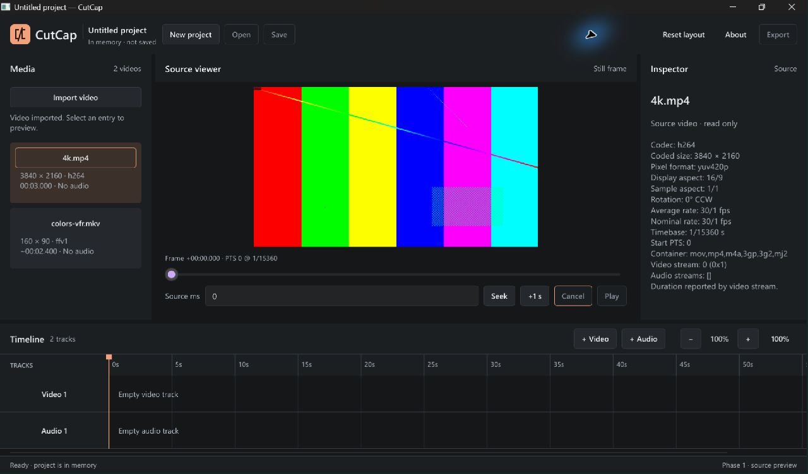

# Phase 1 — Real media import and source-frame preview

Date: 2026-11-03. Windows 11 x64 / MSVC. Branch: codex/phase-1. Phase 0 commit 71641a9 was audited before implementation; its existing tests and core model remain intact. This report distinguishes implemented behavior, actual local evidence and limitations. No remote CI execution or distribution release is claimed.

## 1. Implementation

CutCap now opens a native Windows video picker, probes real local media asynchronously, validates metadata, registers a genuine core MediaAsset through the existing project owner and displays actual library/inspector information. Selecting a source requests its initial decoded frame. The source slider, whole-millisecond field/Seek/Enter and +1 s request further real frames without moving the timeline playhead. The last valid frame remains during seeking; source changes clear it. Loading, cancellation and typed failures are explicit. Playback, audio output, timeline editing, saving and export remain unavailable.

The existing Slint app is extended, not replaced. The new cutcap-media crate isolates native process/codec compatibility. Core has no new GUI/media dependencies and schema stays 1. Contract version increases from 1 to 2 for registration, source selection and metadata snapshots. No handwritten unsafe or unstable GPU interop was added.

## 2. Changed files

- Root: Cargo.toml, Cargo.lock, AGENTS.md, CLAUDE.md, README.md, PRODUCT.md, DESIGN.md.
- apps/cutcap: Cargo.toml; src/main.rs, coordinator.rs, engine.rs, preview.rs; new src/media_ui.rs and benchmark.rs.
- apps/cutcap/ui: app-window.slint, models.slint; components/action-button.slint, media-panel.slint, viewer-panel.slint, inspector-panel.slint. Existing timeline/splitter behavior is retained.
- crates/cutcap-contracts/src: lib.rs, messages.rs, time.rs; new media.rs.
- New crates/cutcap-media: Cargo.toml; src/lib.rs, backend.rs, probe.rs, process.rs, cancel.rs, frame.rs, latest.rs; tests/ffmpeg_integration.rs.
- scripts: new generate-fixtures.ps1 and measure-preview.ps1. Existing verify.ps1 remains the check entry point.
- tests: ui_smoke.md; new fixtures/README.md and eight small generated media/error fixtures (CFR, VFR, A/V, audio-only, rotation, offset, Unicode/space path and corrupt input).
- docs: ARCHITECTURE.md, ENGINE_UI_CONTRACT.md, DECISIONS.md, DEVELOPMENT_RULES.md, LICENSE_REVIEW.md, MODEL_RESPONSIBILITIES.md, ROADMAP.md, SETUP_WINDOWS.md, this report, images/phase1-preview.jpg and measurements/phase1-preview.json.

Historical PHASE_0_REPORT.md is preserved. No FFmpeg executable, codec DLL, installer, source footage or performance-source video is included. The fixture directory is about 254 KB including its README. Build/log/performance source artifacts stay ignored under .artifacts and target.

## 3. Backend and resource ownership

MediaBackend is a small replaceable probe/decode contract implemented by FfmpegBackend. It runs external FFprobe/FFmpeg 9.0.1 directly with argument arrays, stdin null, no console and no shell. CUTCAP_FFMPEG/CUTCAP_FFPROBE override PATH discovery. Workers own processes and buffers; no worker touches Slint or mutates Project. A future libavcodec/hardware adapter can preserve the same metadata, cancellation, timestamp and frame contracts.

One cancellable probe task returns small metadata; only the original project owner commits it. Decode has one active request, one replaceable pending request and one replaceable completed outcome. New work cancels/supersedes old work. ProjectId/MediaId/RequestId gate both successes and failures in worker and presenter. Reliable project results (channels capacity 32, drain ≤8/33 ms) never carry frames. Subprocess stdout/stderr are read concurrently with caps; timeout/cancel paths kill/reap before reader joins. Closing the UI cancels/joins media before reliable transport teardown and project-worker join.

Input budgets: local nonempty regular file ≤32 GiB, source edges ≤4096 and pixels ≤4096×2160, duration ≤24 h, ≤64 streams, probe JSON ≤1 MiB. Probe timeout 15 s, decode 20 s. Decode uses 2 codec threads, 1 filter/output thread and a 64 MiB maximum individual FFmpeg allocation. Preview RGBA8 is ≤1280×720 / 3,686,400 bytes, packed width×4 stride with exact length and alpha 255. Protocols are limited to file/pipe. Full budgets are in ARCHITECTURE.md.

These limits do not impose a total RSS cap or OS sandbox. Local filesystem canonicalization/stat calls cannot be interrupted by the child-process timeout; pathological filesystem/device/reparse behavior remains a shutdown risk. Native rfd dialog cancellation uses its own Cancel button; dropping its future has no documented programmatic dialog-close guarantee.

## 4. Timing and preview flow

Relative UI milliseconds → checked rational ceil conversion → source start PTS addition → PreviewTicket/DecodeRequest → isolated latest decoder → owned validated RGBA8/actual PTS → UI ticket check → preview.rs → supported SharedPixelBuffer/Image APIs.

The explicit policy is **first original presentation timestamp at or after request**. VFR uses actual PTS, not nominal fps. FFmpeg demux seeking uses absolute timestamps and one-second preroll with copyts/noaccurate_seek, followed by explicit PTS selection. The offset regression fixture exposed automatic accurate_seek discard returning no frame; disabling that redundant discard fixed the tested behavior. The first showinfo record from a uniquely named filter supplies actual integer PTS/timebase; missing PTS fails rather than copying requested time. A forged media title reproduced false PTS 999999 instead of 0 with the broad original parser. The fix accepts only the exact filter prefix containing the fresh unpredictable RequestId; parser and real-media regression tests pass. The textual interface must be retested on upgrades.

After the last frame PTS, NoFrame can occur even inside nominal duration. No last-frame fallback is fabricated. Tests cover CFR beginning/middle/end, irregular VFR positions, positive-offset sources and rotated content; arbitrary codecs, negative/discontinuous PTS and every long-GOP/edit-list case are not proven frame-accurate.

FFmpeg auto-orients quarter-turn matrices; square-pixel preview sizing follows DAR/SAR/rotation. SDR converts through RGB24 into opaque RGBA8 (source alpha discarded). HDR/PQ/HLG/BT.2020, reflections, skew/scaling/translation matrices and non-quarter turns are rejected. Unknown SDR color metadata uses FFmpeg defaults; this is not color-critical/HDR grading.

## 5. Supported media and limits

Initial picker extensions: MP4, MOV, M4V, MKV, WebM, AVI, TS, plus All files for explicit error handling. Accepted probed container families are MOV/MP4, Matroska/WebM, AVI and MPEG-TS. The first non-cover video stream is selected; actual codec availability depends on the external runtime. Real tests exercise FFV1 and H.264, plus AAC/PCM audio presence. A filename extension is not a decoding guarantee. Audio-only/invalid inputs fail without registration.

Metadata reports codec, coded resolution, pixel format, aspect ratios, rotation, reported nominal/average rate, timebase/start/duration, audio indices, container and video stream identifiers. Missing optional fields stay unknown; container-duration fallback is marked estimated only when present. A reliable integer stream start_pts is required; rounded decimal start_time is not substituted for observed PTS. Assets/metadata/selection remain in memory. No file watcher, persistence, stream chooser, hardware decode, proxy/cache or source-change fingerprint exists.

## 6. Automated validation

| Executed command | Actual result |
|---|---|
| ./scripts/verify.ps1 | All five stages passed locally: formatting, Clippy, tests, debug build, release build |
| cargo fmt --all -- --check | Exit 0 |
| cargo clippy --workspace --all-targets -- -D warnings | Exit 0 |
| cargo test --workspace | Exit 0; 29 passed, 0 failed; 6 explicitly ignored (5 external-runtime tests and 1 child-process helper) |
| cargo build --workspace | Exit 0 |
| cargo build --release | Exit 0 |
| cargo clippy --workspace --all-targets --all-features --locked -- -D warnings | Exit 0 |
| cargo test --workspace --all-features --locked | Exit 0; same 29 passed / 6 ignored |
| cargo test -p cutcap-media --test ffmpeg_integration -- --ignored --test-threads=1 | Exit 0; 5 passed, 0 failed, 0 ignored |
| cargo run -p cutcap --features gpu-diagnostics -- --gpu-info | Exit 0; Intel Graphics Dx12 IntegratedGpu, Microsoft Basic Render Driver Dx12 Cpu |
| cargo metadata --locked --no-deps --format-version 1 | Exit 0 |
| git diff --check | Exit 0 |

The original 16 Phase 0 tests remain. New tests cover metadata parsing/missing/malformed/oversized values, exact signed timestamp rescaling/overflow, orientation/aspect, HDR limits, invalid dimensions/stride/length/alpha, project registration atomicity/scope, latest pending replacement, stale error/success rejection, cancellation, worker shutdown, failed spawn/exit, output budgets and active child termination/reaping. A cancellation review fixed the predicate/wait notification race by synchronizing the update and checking the predicate under its mutex; an eight-waiter/sticky-cancellation regression test passes. The helper launches the test executable as a deliberately failing/flooding/hanging child; normal tests invoke it explicitly. No tool installation is needed for default tests.

Real integration tests cover known CFR colors/PTS, VFR ceiling selection, near-last/no-frame requests, audio metadata, rotated pixel content, Unicode/spaces, positive source offset, missing/corrupt/audio-only input, absent tools and pre-cancelled requests. Independent ffprobe -show_frames confirmed CFR PTS 0,250,…,2750 and VFR 0,200,700,1500,2300. All-features checks and DX12 enumeration do not establish video GPU performance.

Windows CI remains configured with locked build/cache/format/all-features tests/Clippy, without secrets or publishing. External FFmpeg integration is explicit/local; default CI does not install it. No remote is configured and no remote CI success is claimed. Machine-local full check logs/exit-code JSON are in .artifacts/verification.

## 7. Native Windows evidence

Actual debug and release windows were operated through Windows input/accessibility at Slint scale 1.5 on the 1920×1200 laptop display. Verified native picker and Ctrl+I from focused controls, real library metadata, H.264 test-pattern display/audio presence, CFR red PTS 0 → green PTS 1000, slider source seeking and VFR 201 ms → blue PTS 700. Timeline stays at zero. Repeated source switching returned the final selected source; stale-generation guarantees are additionally exercised with controlled overlapping worker tests.

Normal, maximized and minimum client sizes were inspected. Native edge dragging reached the 1000×600 minimum (1003×631 captured outer logical size); source controls remained visible and inspector/library could scroll. Playback/Save/Open/Export stay disabled; source selection/+1 s tooltips were readable. Corrupt import produced a failure with asset count unchanged and the previous image retained. The earlier release closed cleanly with event-loop shutdown logged, empty stderr and no remaining CutCap/FFmpeg/FFprobe processes.

Testing exposed and fixed Slint widget bindings being severed by user input: after dragging, source selection had updated the image/time but left the slider thumb stale; text entry could similarly retain an old value. Final release regression passed for drag → +1 s, source replacement → zero reset, and typed 201 ms → +1 s updating both widgets. A visibly pending 4K decode was cancelled; the last valid frame remained, and no FFmpeg/FFprobe process remained. Track creation/selection → Ctrl+Shift+A → Ctrl+N also passed, clearing imported assets and restoring two empty tracks without losing keyboard interaction. Close-during-pending evidence is recorded below.

Native file-dialog Cancel was also exercised: no asset was registered and the library reported Import cancelled. Closing the release while a real 4K 2800 ms request was visibly Decoding returned application exit code 0; shutdown logged, stderr was empty, and CutCap/FFmpeg/FFprobe process count was zero. Logs: .artifacts/ui-smoke/phase1-final-stdout.log and phase1-final-stderr.log. The rebuilt debug window also exposed named Source-media position and Source time in milliseconds controls in Windows accessibility, then exited 0. No full screen-reader, other-DPI, multi-monitor, physical scanout-latency or packaged clean-machine test is claimed.

## 8. Performance observations

Retained evidence: measurements/phase1-preview.json, including the measured release executable SHA-256. The main table uses three final release app processes, three synthetic H.264/yuv420p 30 fps / 3 s sources per process, ten positions per source: 0,250,500,750,1000,1250,1500,2000,2500,2800 ms. Total 90 final frames, 30/source resolution, including 3 first imports and 27 seeks per resolution. A prior 90-frame experiment is retained separately in prior_runs to expose variation. The real project registration/latest decoder/Slint software UI path ran, with ≥100 ms settling between requests. No concurrent Cargo builds ran in these retained experiments. Desktop background apps stayed open; power state and OS file cache were uncontrolled. This is a small synthetic workstation observation, not a production benchmark.

Hardware: Intel Core Ultra 7 255H, integrated Intel Graphics driver 32.0.101.9150, 16,582,352,896 bytes RAM; Windows 11 x64 10.0.26300; Rust 1.99.1 release thin LTO; Slint 1.18.1 winit/software, scale 1.5; external FFmpeg/FFprobe 9.0.1. All previews fit 1280×720.

Values below are milliseconds, median [minimum–maximum]. Median uses the upper middle sample for even counts. Probe/decode durations include subprocess startup, pipe capture and reaping, not only codec execution. Initial latency starts at probe submission (excludes human file picking). UI latency ends after image assignment, **not physical paint/scanout**. Copy duration includes the explicit Slint buffer copy and related UI property assignment.

| Source | Probe (n=3) | Initial import → UI (n=3) | Seek → UI (n=27) | Decode process (n=30) | Copy/assignment (n=30) |
|---|---|---|---|---|---|
| 1280×720 | 106.1 [95.7–112.4] | 297.9 [264.1–298.0] | 167.9 [132.6–233.9] | 142.7 [113.1–223.3] | 1.26 [1.07–2.71] |
| 1920×1080 | 79.2 [78.0–82.0] | 300.2 [267.6–301.0] | 203.7 [168.2–399.9] | 195.2 [130.1–371.5] | 1.33 [1.06–2.70] |
| 3840×2160 | 102.0 [99.7–104.7] | 402.7 [399.3–403.2] | 502.3 [301.1–805.2] | 462.8 [211.9–795.0] | 1.13 [1.04–2.48] |

One packed preview is exactly 3,686,400 bytes (3.516 MiB). Roughly three such buffers can coexist at assignment; Slint renderer/source codec memory is additional. Final application-only 100 ms samples observed peak working sets 48.9–49.7 MiB and private bytes 25.7–26.1 MiB. Child FFmpeg/FFprobe memory was not measured; this is not whole-pipeline peak RSS. Final maximum UI timer gaps were 55.8, 78.7 and 75.0 ms; polling continued during decode. The prior experiment contained a 54.47 ms 1080p copy/assignment wall-time outlier and a 92.6 ms heartbeat gap. Its cause was not profiled; it remains in the evidence rather than being hidden by the final medians. These observations do not establish frame-pacing/latency guarantees.

CPU presentation is sufficient for this request-based preview milestone. The measured copy cost is much smaller than per-request decode/process time. Phase 2 should investigate persistent decoding and playback clocks first; these observations do not justify unstable GPU texture interop or establish 30 fps playback capability. Physical display timing remains unmeasured.

## 9. Licensing and dependencies

No FFmpeg/FFprobe executable or native library is bundled, copied, downloaded by scripts/CI or redistributed. The owner-authorized installed external GPLv3/static Gyan 9.0.1 build remains a development dependency. A subprocess boundary does not automatically settle licensing; exact runtime source/notices/build/codec/distribution obligations remain open before shipping. See LICENSE_REVIEW.md and FFmpeg's official legal guidance linked there. Application licensing is still undecided; Slint About attribution remains.

New direct dependency rfd 0.17.2 is MIT, with default features off. serde_json 1.0.154 is now used for bounded probe JSON and measurement reports, not only tests. Existing pins remain Rust 1.99.1, Slint/slint-build 1.18.1, serde 1.0.229, uuid 1.29.0, thiserror 2.0.21, tracing 0.1.44, tracing-subscriber 0.3.23, optional wgpu 30.0.1/pollster 1.0.1. Cargo.lock records the resolved graph. Generated fixture content is CC0-1.0 only; no application license was assigned.

## 10. Acceptance and remaining limits

- [x] Real native selection, actual validated metadata, genuine registration/library, source selection, decoded CPU frame and further source seeking.
- [x] Isolated heavy work, bounded latest requests/results and stale-generation rejection for frames/errors.
- [x] Typed errors, loading/cancellation, subprocess timeout/termination/reaping and worker cleanup regression coverage.
- [x] Existing Phase 0 tests retained; new automated tests and Windows debug/release builds pass.
- [x] Actual native import, metadata, frame, seek, repeated selection, invalid import and layout interactions exercised.
- [x] Measurements/methodology/buffer limits recorded; no binary redistribution introduced; architecture/contract/governance docs updated.
- [x] Final native slider/text synchronization regression: drag → +1 s updates both; select another source resets both to zero; typed 201 ms → +1 s updates text to 1201 ms and slider consistently.
- [x] Native close while a real 4K request at 2800 ms was visibly Decoding with Cancel enabled; application exited 0, shutdown logged, stderr empty and zero CutCap/FFmpeg/FFprobe processes remained.
- [ ] Physical display latency, other DPI/monitor matrix and full assistive-technology validation (additional validation, not claimed).
- [ ] Arbitrary codec/container accuracy, negative/discontinuous PTS, source fingerprinting, HDR/color management and hostile-input OS sandbox (future engineering).
- [ ] Application/runtime distribution licensing, installer/clean-machine packaging and remote CI run (not performed).

## 11. Phase 2 and collaborator handoff

Implement a bounded persistent **video-only source transport experiment** using real PTS/frame durations and an explicit presentation clock, maintaining latest-seek cancellation and the CPU fallback. Measure startup/seek/pacing/memory on long-GOP/B-frame/VFR/negative-start files; investigate native FFmpeg binding or persistent subprocess choices from evidence. Do not add multi-track/audio/export concurrently. Add bounded atomic project save/open, re-probe/fingerprint policy and migration entry before serious editing work.

Sol retains media/backend/time/cancellation/performance/core ownership. Claude can review/refine source-viewer UX, keyboard/accessibility, library/inspector and UI tests once available. Both follow AGENTS.md, contract 2 and schema 1; preserve UI-thread-only Slint, stable row focus, exact source/timeline distinction, latest ticket/error rejection and preview.rs presentation boundary. Shared contract changes update both ends/tests/docs together on coordinated isolated branches/worktrees. No progress depends on another model.
