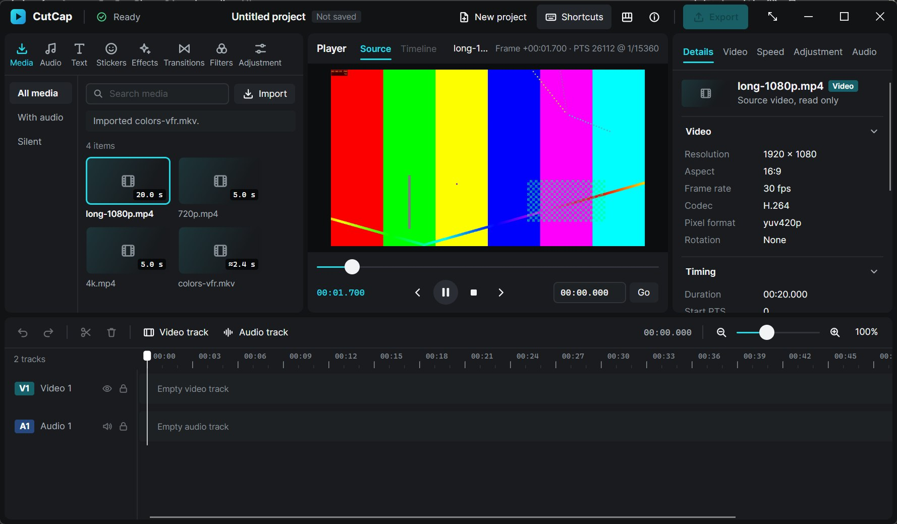

# Phase 2B — Production playback UI

Date: 2026-11-04. Branch `claude/phase-2b-playback-ui`, based on `bab1659`. That commit is Sol's verified Phase 2 engine and ABI 2, committed unmodified as its own baseline. Implemented by Claude Opus 5.5. Machine: Core Ultra 7 255H, integrated Intel Graphics, 16 GB, Windows 11 x64, 1920×1200 at 150 % scaling, 60 Hz panel.

## 1. Implemented changes

- **Player transport is live on ABI 2.**
  - Play/Pause toggle, Stop, the scrubber, the step buttons and the go-to field all call the existing engine.
  - The Play/Pause glyph and accessible name come from the engine's state and its "desired playing" intent, never from the click.
  - Starting, Seeking, Buffering and End of source appear as a small chip on the stage, driven only by the typed state.
  - Failed shows the engine's error in a banner and keeps Play available.
- **Readout semantics.**
  - Once a playback epoch has delivered a frame, the cyan readout shows that copied frame's source time.
  - Otherwise it shows the requested position, and the accessible name says which one is shown.
  - The go-to field follows the requested position only, so typing is never overwritten by playback.
- **Scrubbing.**
  - Keyboard steps seek immediately.
  - A pointer drag seeks at most once every 120 ms (latest position wins) and once more on release, never repeating a target within one gesture.
  - While a drag is in progress, engine updates don't move the thumb.
  - While a seek or start is outstanding, the thumb holds the requested position instead of snapping back to the old frame.
- **Space toggles playback** anywhere in the workspace, including over the media list, except:
  - in text fields, where Space types a space;
  - on a focused button or toggle, where Space activates it.

  Enter is never taken. Space is listed in the Shortcuts sheet.
- **No per-tick rebuilds.** During playback the view changes on every pump, but the library, inspector and timeline are re-applied only when their own data changed (`ViewChanges`). Only the player updates per frame.
- **Render-loop pumping.** While playback is active, `EngineHost` also pumps once per compositor frame through `TopLevel.RequestAnimationFrame`. The 16 ms timer remains the idle and backstop path. This was measured to cut render gaps over 40 ms from ~30–35 % to ~7–16 % (section 8). `CUTCAP_PUMP_MODE=timer` restores the old behaviour for A/B runs.
- **Diagnostics (opt-in only).** `CUTCAP_TRACE_PLAYBACK=1` logs UI transport commands and engine state transitions as the UI received them. Sol's `FrameView.FrameRendered` hook is unchanged, and no production logic depends on either.
- **New icons:** Pause and Stop, generated like the others.

## 2. Modified files

| Area | Files |
|---|---|
| View models | `ViewModels/Transport.cs` (new: `Transport.Map`, `ScrubController`), `ViewModels/ViewChanges.cs` (new), `ViewModels/PlayerViewModel.cs`, `ViewModels/MainWindowViewModel.cs` |
| Services | `Services/EngineHost.cs` (render-loop pumping, `PlaybackActive`), `Services/PreviewTrace.cs` (transport trace) |
| Views | `Views/PlayerPanel.axaml` and `.cs` (transport, chip, scrub gesture), `Views/MainWindow.axaml.cs` (Space), `Views/ShortcutsView.axaml`, `App.axaml.cs` (attach render loop) |
| Assets | `Assets/Icons/pause.svg`, `stop.svg`, regenerated `Controls/IconData.g.cs` |
| Tests | `tests/CutCap.Desktop.Tests/TransportTests.cs` (new, 19 tests), `tests/CutCap.Interop.Tests/PlaybackTests.cs` (+1 test) |
| Scripts | `scripts/native-ui/playback-ui.ps1` (native scenario), `cadence.py`, `cadence-resources.py` |
| Docs | this report, `docs/measurements/phase2b-cadence.json`, `phase2b-native-scenario.txt`, `docs/images/phase2b-*.jpg`, ARCHITECTURE, DESIGN, DECISIONS (ADR 017), ROADMAP, README, PHASE_2_PLAYBACK_CONTRACT (integration status), `tests/ui_smoke.md` |

No Rust, ABI or engine file changed. ABI 2 is used exactly as Sol defined it.

## 3. Playback UI architecture

The engine stays authoritative, and the data flows one way:

> Rust session (state machine, clock, scheduler, generation gate) → pump → coalesced `SessionView` → `Transport.Map` → player properties.

Frames take a separate path: `FrameChanged` (by generation) → `FrameView.Present` → `cutcap_session_copy_frame` into the reused `WriteableBitmap` → `InvalidateVisual`.

Commands go the other way: `PlayerViewModel` → `EngineHost.Run` → `EngineSession.Play/Pause/Stop/Seek/SeekText`. These calls are non-blocking and return acceptance only; the UI changes when the next view arrives. Nothing in the frontend keeps a clock, counts frames or estimates position.

## 4. State and time binding decisions

| UI element | Bound to | Why |
|---|---|---|
| Play/Pause glyph | `desired_playing` ∧ state ∈ {starting, playing, seeking, buffering} | Reflects intent while the engine works toward it; Ended and Failed offer Play |
| Stop enabled | source ready ∧ state ≠ stopped | Stop ends an epoch; while stopped there is nothing to stop |
| Readout | `playback.copied_ms` once the epoch has copied a frame; else `requested_ms` (or `source.position_ms` when stopped) | Delivered pixels, not a clock and not a request; labelled accordingly |
| Scrubber | readout, except it holds `requested_ms` while seeking/starting and the user's value while dragging | No fake "seek done"; no snap-back; no feedback loop (`_applying` guard) |
| Go-to field | requested position only | It edits the request; playback must not overwrite typing |
| Chip | typed state (Starting / Seeking / Buffering / End of source) | No invented progress |
| Isolated-decode banner and Cancel | only while stopped and `source.busy` | During playback `source.busy` means the chip states |

`source.position_ms` keeps its Phase 1 meaning (last requested seek). The timeline playhead is untouched by all of this.

## 5. Native interop integration

The integration uses only `EngineSession` as Sol shipped it: `Play`, `Pause`, `Stop`, `Seek`, `SeekText`, `ReadView`, `TryGetFrameInfo` and `CopyFrame`.
- A `STALE_FRAME` result after an epoch changes is handled by `FrameView` (it keeps the last image), so no frame of an obsolete source or epoch is ever drawn.
- Shutdown order is unchanged: the pump timer stops, the render loop is detached, then the session is disposed.
- No ABI defect was found, so the contract stays at version 2.

## 6. Automated test results

| Command | Result |
|---|---|
| `./scripts/verify.ps1` | Exit 0, all nine stages (see the final verification note below) |
| `cargo test --workspace` | 52 passed, 8 ignored (unchanged engine) |
| `dotnet test CutCap.slnx` | 49 passed (desktop 28, interop 21), 0 failed or skipped |

**New desktop tests:**
- the state-to-controls table for all eight states;
- no-source and not-ready cases;
- Ended replay and the Failed error;
- copied versus requested readout, including seeking and stopped;
- the playback busy state not showing the isolated-decode banner;
- immediate keyboard scrubs;
- throttled, latest-wins drags with a final seek on release;
- no duplicate seek on release, and cancelling a drag;
- playback ticks not touching the library, inspector or timeline;
- the go-to field surviving playback ticks;
- the scrubber not being overwritten mid-drag;
- a source switch ending a drag.

The throttle test caught a real overflow bug in the first version of `ScrubController`, which would have suppressed every drag seek until release. It was fixed before the native runs.

**New interop test** (real DLL and FFmpeg): pausing before the epoch's first frame stays paused when that frame arrives; playing to the end gives Ended, which keeps the last frame (≥ 2.5 s into the 3 s clip); Play at Ended starts a new epoch from 0; and Stop is reported Stopped at once, with the zero frame claimed only when it arrives (PTS 0).

## 7. Human-operated Windows test results

`scripts/native-ui/playback-ui.ps1` drove the real app (Debug build) with real mouse and keyboard input. It is gated on CutCap owning the foreground. The log is in `docs/measurements/phase2b-native-scenario.txt`; the engine transitions were cross-checked with `CUTCAP_TRACE_PLAYBACK=1`.

| Scenario | Observed |
|---|---|
| Play / Pause (1080p, 20 s clip) | Button flips 236 ms after Play, 158 ms after Pause; readout advances while playing; two paused screenshots 0.8 s apart are identical |
| Space toggles | From a list item: Pause, then Play. In the search field: a space is typed and playback is untouched |
| Seek while paused | 1500 ms request, stays paused |
| Seek while playing | 1000 ms request, keeps playing (button stays Pause) |
| Rapid scrubbing while playing | 5 seeks in 0.5 s; each a new epoch, intent preserved, only the last (14,197 ms) presented |
| Stop | Back to 00:00.000, button Play |
| Seek while stopped, play to end, replay | 18.5 s request, then End of source after 1.6 s with the final frame (19.966 s) held; Play restarts from 0 |
| Resize during playback | 1800×1050 → 1440×900 → back; playback continues |
| Switch source while playing | Old epoch cancelled; 720p selected and stopped; Play works |
| 4K playback | Plays (screenshot); start latency ~170 ms |
| VFR (`colors-vfr.mkv`) to end | End of source after 2.3 s |
| New Project during playback | Library empty, preview cleared, Play disabled |
| Corrupt file | "FFprobe could not read this video…", nothing registered |
| Close during 1080p playback | Exit 0 in 550 ms; no CutCap/FFmpeg/FFprobe left |
| Close during a pending 4K seek | Chip showed "Seeking…"; exit 0 in 532 ms; nothing left |

Screenshots: `docs/images/phase2b-playing.jpg`, `-paused`, `-ended`, `-4k` and `-resized`.

**Not exercised natively:**
- **Pause before the first frame:** my accessibility-tree clicks take about 0.9 s, longer than 4K's ~170 ms start, so this is covered by the interop test only.
- **Missing file:** not tested natively; it is covered by Sol's interop test, where a source deleted during playback fails cleanly.
- **Seek while buffering:** buffering never lasted long enough to target.
- **Release build in the scenario:** the scenario used the Debug build; the Release build was used for the cadence runs.
- **Other conditions:** other DPI scales, multiple monitors, screen readers and long sessions.

## 8. Playback performance observations

**Method.** Sol's unchanged probe (`tools/CutCap.PlaybackProbe --ui`) drives the actual editor through public interop and records distinct `FrameView.DrawImage` generations. Those are render callbacks, not physical scan-out. Sources are synthetic 5 s H.264 30 fps files at 720p, 1080p and 4K, with previews bounded to 1280×720. Each configuration ran 3 episodes per source, and the render-loop configuration was run twice, for variability. Raw data is in `docs/measurements/phase2b-cadence.json`, summarised with `scripts/native-ui/cadence.py`. The background workload was normal; power and cache state were not controlled.

| Configuration | Source | Renders / 150 | Render FPS | Gap p50 / p95 / max (ms) | Gaps > 40 ms | Native drops / stalls |
|---|---|---|---|---|---|---|
| Baseline (Sol tree, timer, full apply) | 720p | 150 ×3 | 29.34–29.46 | 31.4 / 51.4 / 66.8 | 35 % | 0 / 0 |
| | 1080p | 148–150 | 28.80–29.29 | 31.5 / 52.0 / 64.3 | 35 % | 0–2 / 0 |
| | 4K | 149–150 | 28.89–28.96 | 31.7 / 50.2 / 60.8 | 35 % | 0–1 / 0 |
| Phase 2B, timer only | 720p | 150 ×3 | 29.27–29.34 | 31.6 / 50.9 / 63.0 | 29 % | 0 / 0 |
| | 1080p | 150 ×3 | 29.01–29.29 | 31.3 / 49.5 / 62.3 | 35 % | 0 / 0 |
| | 4K | 148–150 | 28.65–29.12 | 31.4 / 49.8 / 71.2 | 33 % | 0–2 / 0 |
| Phase 2B, render-loop pump (runs 1 and 2) | 720p | 150 ×6 | 29.28–29.62 | 33.3 / 41.9 / 51.0–65.5 | 9–10 % | 0 / 0–1 |
| | 1080p | 150 ×6 | 29.34–29.55 | 33.2 / 41.6–45.7 / 61.3–76.1 | 7–10 % | 0 / 0–1 |
| | 4K | 150 ×6 | 28.99–29.15 | 33.1–33.2 / 48.8–50.3 / 61.8–73.7 | 13–16 % | 0 / 0–1 |

**Findings.**
1. **The cause was timer quantization, not decoding or copying.** The baseline gap histogram is bimodal at 16–31 ms and 40–48 ms, identical at 720p and 4K, with zero native drops. The scheduler only advances in pump, and the 16 ms `DispatcherTimer` fires on Windows' ~15.6 ms timer ticks. A frame due every 33.3 ms is therefore offered either 31 or 47 ms after the previous one.
2. **Render-loop pumping centres the cadence on 33.3 ms.** Pumping in `RequestAnimationFrame` (once per compositor frame, before render) puts the median exactly on the frame duration and cuts outliers about threefold. The remaining outliers come in 16.7 / 50 ms pairs: a frame due just after a 60 Hz vsync waits one more vsync. Removing these would need the engine to offer frames by a vsync-aligned deadline, which is a scheduler change for the engine owner, not attempted here.
3. **At 4K, the render-loop runs showed 0–1 buffer stalls per episode** (none under timer-only), and a higher outlier share. 4K decode-plus-pipe runs at about 124–129 fps unpaced (Sol's report), so the decoder is closer to its limit. This was not investigated further.
4. **Engine quirk to report:** every new epoch reports Playing → Buffering → Playing within about 15 ms of its first frame, and counts one buffer stall. That flashes the Buffering chip for one frame and inflates the stall counter. Recommended to Sol; not changed here.
5. **No measured change in resources.** Memory, CPU and seek latency are the same across configurations. Peak host-plus-decoder working set was 389–408 MiB at 720p, 413–429 MiB at 1080p and 516–541 MiB at 4K. Machine-normalised CPU was 3.5–9.5 %. Seek-to-render medians were about 155–170 ms at 720p, 245–255 ms at 1080p and 670–700 ms at 4K.

**Smooth, locked 30 fps playback is not established:** p95 gaps remain 42–50 ms, and maxima reach 50–76 ms. Physical presentation and scan-out were not measured.

## 9. Known limitations

- Render cadence is improved but not locked (section 8). It depends on the 60 Hz display and Avalonia's render timer; other refresh rates were not tested.
- One-frame Buffering blips at the start of each epoch (engine behaviour, section 8.4).
- Seeking after End of source lands paused, because the engine's intent is no longer "playing". This is engine-defined and consistent with Pause.
- Rapid drag seeks restart the decoder for each throttled target (every 120 ms or more), which is correct but costs a process launch each time at 4K.
- Video only: no audio, no timeline playback, no loop. Last-frame duration isn't guessed, so the final readout can be just short of the container duration.
- Native coverage gaps are listed at the end of section 7.

## 10. Recommended next phase

1. **Engine (Sol):** a vsync-aware offer deadline, plus removing the start-of-epoch Buffering blip and its stall count. Both would directly reduce the remaining outliers.
2. **Frontend:** poster-frame thumbnails for the library, using the persistent decoder or an isolated request.
3. **Validation:** test on 120/144 Hz displays and at other DPI scales, and run longer real-world sources.
4. **Then:** timeline playback (Phase 3), which needs clips and shared timeline evaluation first.

**Final verification:** `./scripts/verify.ps1` re-run on the final tree exited 0 on all nine stages: fmt, clippy, cargo test (52 passed), debug and release builds, dotnet build, dotnet test (49 passed), dotnet Release build and the self-contained publish. Evidence is in `.artifacts/verification`.
