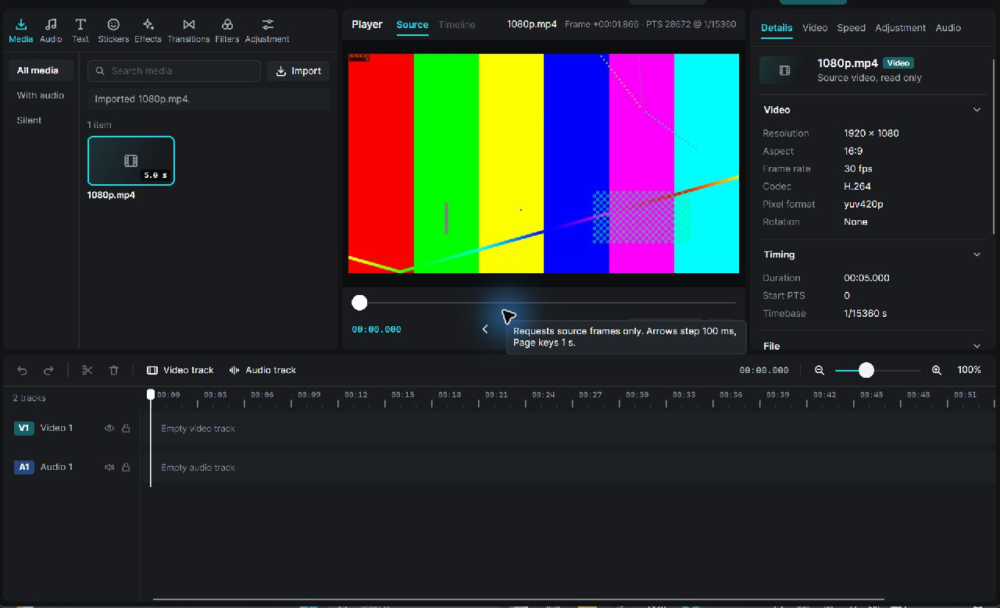

# Phase 2 — Persistent source playback engine

Date: 2026-11-04. Branch: codex/phase-2-playback, based on migration/avalonia-ui commit 443b7cd. The migrated baseline was clean and all nine verification stages passed before implementation. This is Rust engine/ABI/managed interop work over the existing Avalonia app. No frontend migration reversal or visual redesign occurred.

## Implemented result and handoff status

The engine now continuously decodes a selected source, schedules real timestamped frames with a monotonic clock, and exposes Play, Pause/Resume, Seek and Stop through ABI 2 and CutCap.Interop. It handles buffering, EOF, cancellation, source replacement and failures with bounded queues and generation gates. The isolated Phase 1 frame-request route remains available while stopped. Core project/timeline semantics, schema 1 and project-command contract 2 are unchanged.

The owner will relay PHASE_2_PLAYBACK_CONTRACT.md to Claude; Claude's review/agreement is not claimed. Production visual Play/Pause/Stop bindings are still frontend-owned and remain disabled/unmodified in this change. The owner explicitly authorized a diagnostics-only FrameView.Render hook and a driver which opens the **actual existing Avalonia editor**. That driver exercised real playback through public interop methods and the original EngineHost pump. It did not simulate playback, create replacement views or move the timeline playhead.

## Changed modules

- cutcap-media: backend.rs adds the real streaming operation; new stream.rs (framed transport/parser), persistent.rs (bounded epoch worker), clock.rs (monotonic clock), examples/measure_decode.rs. process.rs adds safe Windows job resource/lifetime containment. lib.rs/Cargo.toml/Cargo.lock include the implementation and pinned dependency.
- cutcap-ffi: new playback.rs; media.rs/session.rs integrate transport, generation gates and delivery acknowledgments; view.rs adds playback and frame PTS/epoch DTOs; abi.rs exposes controls and ABI 2; tests.rs adds source-transport scope coverage.
- CutCap.Interop: NativeMethods.cs, EngineSession.cs and SessionView.cs mirror ABI 2, typed playback state/time, controls, and a last-read immutable DTO for diagnostics.
- Desktop: only the approved five-line opt-in render hook in Controls/FrameView.cs. No XAML, style, layout, playback-button binding or view-model behavior changed.
- Tests/tools: PlaybackTests.cs, shared test-tool check, FFmpeg integration cases, long-gop-bframes.mp4, generate-playback-fixtures.ps1, the real-app/offscreen PlaybackProbe project and solution entry.
- Root .gitignore adds scoped tools/*/bin and tools/*/obj exclusions; tool build outputs and runtime DLLs are not source artifacts.
- Documentation: playback contract/report, NATIVE_ABI, architecture, decisions, setup, roadmap, engine/UI contract, license inventory and measurement artifacts. Historical migration/Phase 1 reports remain historical.

## Backend choice and framing

| Route evaluated | Decision |
|---|---|
| Per-frame FFmpeg subprocess | Retained for isolated frame requests; repeated startup/redecode is unsuitable for continuous transport |
| Native libavformat/libavcodec | Viable future adapter, but this machine has the external static CLI, not a reviewed matching DLL/header/build/distribution arrangement; no invasive installation or unapproved runtime bundle added |
| Persistent unframed RGBA plus free-form logs | Rejected: image/timestamp association and recovery are too fragile |
| Persistent framed PAM plus indexed mux records | Implemented and tested with FFmpeg 9.0.1; simple bounded packet parsing, exact integer PTS, no video codec implementation in Rust |

One FFmpeg process lives for a playback epoch. Pause/resume retains it and its bounded preroll; seek/source replacement cancels/resets it. Output is image2pipe/PAM RGBA8. Every image has a bounded P7 header, explicit dimensions/depth/tuple type and exactly sized pixel payload. Separately, official stats_mux_pre emits a nonce-tagged record containing packet index, integer PTS, rational timebase and encoded packet byte size. One stream, PAM packet per image, strict sequential indices and header+payload size matching associate bytes and timestamps. No delimiter search through pixels, nominal-fps timestamp generation or generic showinfo parsing is used for continuous playback. Missing/extra/malformed/mismatched records fail explicitly.

The persistent operation remains behind MediaBackend. A future native/hardware implementation can return the same owned frame/time/ticket contract without putting codec/UI/GPU types in core or serialized Project. Existing FFprobe validation and SDR/aspect/quarter-turn orientation rules remain. HDR, non-orthogonal/reflected transforms and color-critical rendering are not implemented.

## Timestamp, scheduling and transport policy

- Integer source PTS/timebase remain authoritative. Requests are source-relative milliseconds converted by checked rational arithmetic; source and project clocks remain distinct.
- First frame is the first PTS >= seek target (the Phase 1 ceiling policy). Source-offset and VFR fixtures validate the actual values. Continuous output must have strictly increasing PTS; duplicated/discontinuous/backwards timestamps fail instead of silently becoming CFR.
- Instant anchors the video-only clock at the first matching frame's actual source time. Pause excludes wall time; Resume keeps the paused epoch. A seek resets the epoch/clock and preserves playing/paused intent.
- The scheduler holds at most two lookahead frames. It offers the newest available due frame, counts superseded due frames as dropped, and holds future frames. It never sleeps or decodes in pump.
- Decoder starvation holds the last image and freezes the clock in Buffering. Recovery resumes from the frozen source time, preserving VFR gaps. Controlled-clock tests cover this, independently of runtime throughput.
- EOF means decoder completion. Ended requires all queued frames to become due and the final offered generation to be copied. Last-frame duration is not guessed from fps: Ended's actual copied position can precede reported container duration. Last image remains; Play at Ended starts a new epoch from zero.
- Stop cancels streaming and asynchronously requests the zero-position isolated frame. Cancel preview stops advancement and keeps the last valid image. New project/source replacement invalidates old frame access and results immediately.

## Acceptance, readiness, delivery and rendering

An OK control return means acceptance/queueing, not decoded readiness or successful playback. Source-not-ready/invalid numeric ranges are typed argument errors. Worker/process failures arrive in the view. New project/source scope and request IDs gate both successes and errors.

Decoded frames, scheduled offers, successful copies and distinct renders have separate counters/measurements. copy_frame success acknowledges that generation's bytes once, not physical display. Source.position_ms keeps its existing requested-position meaning. playback contains separate clock/offered/copied positions, exact timestamps, Rust-formatted strings, epoch, state/intent, readiness latency and counters. Claude must bind playback readouts to the intended copied/clock fields rather than incrementing a frontend media clock.

FrameInfo remains 24 bytes. Pixels stay out of JSON and MVVM; frames are owned by Rust and copied into the existing reusable WriteableBitmap. Native sessions remain opaque registry keys, not caller pointers; panic containment and SafeHandle ownership remain. No native-to-managed callbacks were added. The render diagnostic is a managed opt-in event after DrawImage, deduplicated by generation; it is not scanout or a compositor-present acknowledgment.

## Bounds and cleanup

The worker has one active epoch and one replaceable pending reset. Native decoded queue = 3 frames; scheduler lookahead = 2. Including one reader/in-flight frame and one offered frame, steady continuous preview pixels use at most about seven native buffers (25,804,800 bytes at 1280×720), plus the managed bitmap and codec/renderer storage. An isolated request being cancelled during handoff can briefly retain another buffer. Frames keep Phase 1 dimension/stride/length/alpha validation. Headers <=512 bytes; records/errors are capped. Current-epoch terminal results are separate from pixels. Pause applies backpressure, not growing buffers or spinning.

Windows media children receive a 1 GiB committed-memory limit, one-process cap and kill-on-close job through win-custody 0.1.2 (MIT OR Apache-2.0). Job APIs were inspected; no handwritten unsafe was added outside the established ABI module. Assignment is immediately after spawn; the brief launch window is not claimed sandboxed. This does not restrict filesystem/network rights or total host/renderer memory. Transient isolated/continuous cancellation overlap can briefly have more than one child, each limited.

Child stalls have a decode timeout; intentional consumer backpressure is excluded. Cancellation wakes blocked producers, kills/reaps children and closes pipes before reader joins. The UI stops pumping before disposal; media workers shut down before the command bridge. Filesystem canonicalization/stat calls remain ordinary local worker calls and cannot be interrupted by the child timeout; pathological filesystem behavior remains a limitation.

## Validation

The original migration baseline passed: 45 Rust tests, 24 .NET tests and all nine verify.ps1 stages. Existing tests were preserved. Final local results below are from actual logs; remote CI is not claimed.

| Command/check | Result |
|---|---|
| ./scripts/verify.ps1 | Exit 0, all nine Rust/.NET/build/test/publish stages; no warnings suppressed |
| cargo test --workspace | Exit 0; 52 passed, 0 failed, 8 intentionally ignored (7 external-runtime tests and the child-process helper) |
| FFmpeg integration --ignored --test-threads=1 | 7 passed, 0 failed (including continuous VFR/offset and long-GOP/B-frame oracle/seek) |
| dotnet test CutCap.slnx -c Debug -nologo --no-build | Exit 0; 29 passed (20 real-DLL interop, 9 desktop), 0 failed/skipped |
| Rust formatting / Clippy with -D warnings | Exit 0; all-targets/all-features checks also passed |
| Rust workspace Debug / Release builds | Exit 0 |
| .NET Debug / Release builds and self-contained win-x64 publish | Exit 0 |
| cargo test --workspace --all-features --locked | Exit 0; same 52 passed / 8 ignored |
| DX12 diagnostic (cutcap-ffi --features gpu-diagnostics --bin cutcap-gpu-info) | Exit 0; Intel Graphics Dx12 IntegratedGpu plus Microsoft Basic Render Driver Dx12 Cpu |
| Native editor diagnostics | Nine completed playback episodes, 1,350 final distinct rendered generations, 27 seek-to-render samples; saved report error is null |
| Native close during continuous playback | Observed active 1080p frame at +1.866 s, then Alt+F4. No app/FFmpeg/FFprobe process remained. Diagnostics exit 1 is expected because its nine-episode plan was deliberately interrupted, recorded as Window closed before all benchmark episodes completed, not a claimed successful full run |

Coverage includes clock pause/resume, due-frame dropping, starvation/recovery, EOF waiting for delivery, copied-counter deduplication, full-queue backpressure/cancel/shutdown, stale epochs, source/project replacement, paused/playing rapid seeks, repeated controls, decode failure, version/handle/buffer/stride errors, and kernel job lifetime/memory settings. Real B-frame and seek PTS are compared to independent FFprobe frame output, including a 30000/1001 clock fixture. Source-offset 6250 PTS and VFR 201 ms -> 700 PTS are verified. No tests were weakened to obtain passes.

## Performance experiment

Hardware: Core Ultra 7 255H, integrated Intel Graphics, 16 GB RAM, Windows 11 x64. Rust 1.99.1/MSVC Release, .NET SDK 10.0.401, Avalonia 12.1.5, external Gyan FFmpeg/FFprobe 9.0.1. Three five-second synthetic H.264/yuv420p 30 fps sources, GOP 150 and B-frames, at 720p/1080p/4K; all previews bounded to 1280×720. One actual editor process, three sequential episodes/resolution, unchanged EngineHost pump. Each episode then seeks at 1250,2750,4800 ms while paused. Normal desktop background workload; cache/power state uncontrolled. No concurrent build/other benchmark during retained runs.

Evidence: measurements/phase2-playback.json (summary, source/binary hashes, all nine run records and unpaced decoder trials) and phase2-playback-frames.json.gz (raw frame timing). Percentiles use the upper-middle/nearest sample convention. Render FPS below includes startup and end detection; it is not physical scanout or a smoothness guarantee.

| Source | Unpaced decode+pipe FPS (3 runs) | Distinct renders/episode | Render FPS range | Gap p95 / max (ms) | Seek-to-render median [min,max] ms |
|---|---|---|---|---|---|
| 720p | 260.0 / 274.3 / 295.2 | 150 / 150 / 150 | 29.21–29.37 | 50.63 / 72.14 | 188.84 [141.18,238.14] |
| 1080p | 204.3 / 245.7 / 252.9 | 150 / 150 / 150 | 29.19–29.25 | 50.14 / 58.83 | 272.62 [189.34,375.51] |
| 4K | 123.6 / 125.9 / 129.2 | 150 / 150 / 150 | 28.91–28.92 | 51.47 / 59.24 | 768.15 [450.15,1203.27] |

Final native late-drop/stall counters were zero; an earlier retained summary observed 0–2 native drops and render coalescing. Even with every final frame drawn, gaps reached 59–72 ms and p95 exceeded 50 ms: **locked/smooth 30 FPS or 60 FPS is not established**. Unpaced decoder FPS is intentionally measured separately and must not be marketed as presented FPS.

Median engine-to-bitmap copies were 350 / 363 / 446 microseconds. Maximum background dispatcher sample gaps were 66.2 / 42.6 / 37.4 ms. Sampled combined host+decoder working-set maxima were 416.5 / 451.1 / 569.3 MiB; private-byte maxima 322.3 / 355.9 / 474.9 MiB. CPU normalized to the machine was approximately 9.5–11.5% / 9.4–10.4% / 12.5–12.8%. Sampling is not a hard peak; import/probe peaks are excluded. CPU totals include the decoder child, not just the GUI host.

The existing CPU copy path is sufficient for this measured engine milestone. Remaining pacing work is not justified as a GPU texture-copy rewrite by these copy timings. First complete frontend state/readout binding, then profile cadence/dispatcher/compositor alignment using supported APIs on broader/longer real-world sources. No physical presentation latency, audio synchronization or production performance guarantee is claimed.

## Limitations and Claude integration

- Production Play/Pause/Stop controls/readouts remain unwired by design. Claude receives the contract, managed methods and typed state; no claimed frontend review. Existing source readout remains requested position while the diagnostics driver plays real frames.
- Renderer callback timing is not scanout. The sampled client size was about 1282.7×810 logical pixels at 1.5 scaling on the 1920×1200 laptop; full window placement, other DPI/monitors, accessibility and packaged clean-machine playback need frontend validation.
- Only SDR software decode/CPU presentation; no audio, multi-track playback, editing, effects, export, proxies, persistence or GPU video interop added.
- Duplicate/non-increasing/discontinuous PTS fail explicitly. Arbitrary codecs, negative-start containers, very long sessions, resolution-changing sources and hostile-codec OS sandboxing are not comprehensively validated.
- External FFmpeg remains an owner-authorized GPL/static development runtime, not bundled/downloaded/redistributed. Subprocess use does not resolve distribution licensing; app/runtime distribution and notices still need the owner's review.

Claude should enable transport only against ABI 2, reflect state and desired intent, retain source/timeline independence, use copied versus clock fields deliberately, preserve scrubber feedback guards and list identity, and stop the pump before SafeHandle disposal. Frames stay out of view-model properties. The approved diagnostic hook can remain opt-in; production logic must not depend on it.

Recommended next step: integrate the reviewed playback bindings in the existing frontend, then test human-operated pause/resume/scrub/EOF/source replacement and close under load. Profile measured render-gap outliers before claiming smooth playback or adding GPU interop. No release publishing or commit was performed as an incidental part of this assignment.
