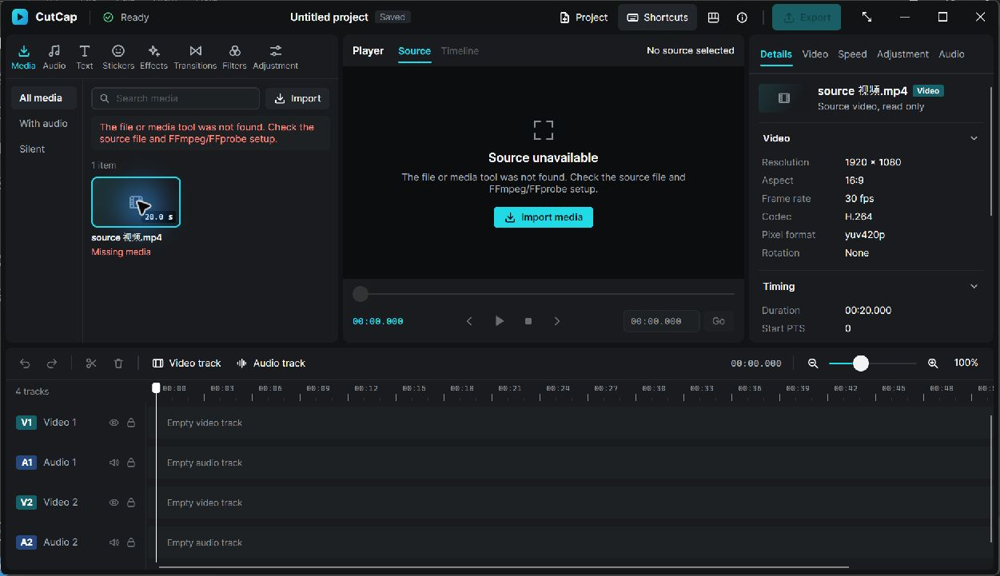

# Phase 3A — Project persistence and playback stabilization

2026-11-04. Implemented on `codex/phase-3a-persistence`, from the complete Phase 2B baseline, with no parallel frontend developer. **The save/open/relink workflow is implemented and verified.** Final Rust/.NET gates and local Windows publish pass. All 27 measured native playback episodes report zero buffer stalls; real starvation remains covered by deterministic clock tests.

## 1. Repository baseline

Started from clean `claude/phase-2b-playback-ui` at `3af9d04`, following `15a24e3` (production playback UI) and `bab1659` (playback engine). Preserved that frontend and its real transport integration. Read AGENTS, CLAUDE, architecture, native ABI, UI/engine contract, decisions, license review, roadmap, migration and Phase 2/2B reports/contracts, then inspected producer/consumer/model/preview code. The unmodified baseline passed all nine verify.ps1 stages: 52 Rust tests, 49 .NET tests, builds and self-contained publish. Launched and inspected its actual Windows window before editing.

Hardware: Windows 11 x64, Core Ultra 7 255H, integrated Intel Graphics (DX12 driver 32.0.101.9150), 16 GB RAM, 16 logical processors. Tested screen: 1920×1200 at 150%. Rust/Cargo 1.99.1 MSVC; actual .NET SDK 10.0.403 (global.json requests 10.0.401 with latestFeature roll-forward); Avalonia 12.1.5. External FFmpeg/FFprobe 9.0.1 essentials/Gyan remain separately installed development dependencies.

## 2. Implementation summary

- Genuine background Save, Save As and validated Open through the authoritative Rust project owner, C ABI and managed EngineSession.
- Separate document and presentation revisions. Completion marks the captured revision saved; later edits remain dirty. New/Open cannot reset a source while a file operation is pending.
- Bounded project format/parser, complete graph validation, same-directory temporary writes/flush/replacement and explicit failure feedback.
- Portable descendant references, full source fingerprints, asynchronous revalidation, retained missing/changed references and original-content relink. Relinking a Ready source also switches its live decoder path even when its MediaId stays the same.
- Existing Avalonia workspace gains a Project menu, native dialogs, real Saved/dirty/failure feedback, title asterisk and Save/Discard/Cancel protection. No UI rewrite, new decoder, timeline editing, audio, GPU rewrite or export.
- Corrected startup preroll readiness without changing frame due deadlines. Frame buffers remain outside project events, JSON and view models.

## 3. Project format and schema policy

`.cutcap` is envelope **format 1** around complete **core schema 1**. No migration was necessary: the existing model already represents identity, name, timeline timebase, ordered tracks/media and supported clip data. A source manifest outside core holds validated metadata expectations and complete SHA-256/length fingerprints. It is revalidated, not trusted as current decoder metadata.

No selection, playback state, pixels, workers, handles, subprocess data, errors or layout is serialized. Unsupported formats/schemas and malformed IDs, values, references, overlaps or unknown fields are rejected. Existing clip graphs round-trip with stable identities/order; the UI labels preserved clip data honestly but does not render or edit clips. Exact format, budgets and policies: [PROJECT_FORMAT.md](PROJECT_FORMAT.md).

## 4. Save/open lifecycle

Commands enqueue without I/O on the dispatcher/ABI. The sole command owner captures a validated snapshot and revision, starts one owned file task, and publishes nonterminal Updated status. The accepted RequestId remains pending through the terminal result. Edits can continue during Save; Open rejects mutations until validated adoption. Only successful replacement updates path/saved revision. Selection, playback and source inspection do not dirty the document.

Opening reads/preflights/parses/validates off-thread and adopts the entire document once. Failure retains the live model, path, selections and source image. Successful adoption resets transient source work, **including reopening the same ProjectId**, then checks sources on the existing single probe worker. Reliable verification results have one retained submission slot for queue backpressure, separate from preview frames. Source scope, cancellation/abandonment and terminal request identity guard stale work.

## 5. File integrity guarantees and limitations

The loader bounds file bytes to 16 MiB before parsing, plus growth checks, nesting 32, string 32,768 UTF-8 bytes, 32 object fields and 100,000 array elements. Typed validation then enforces the complete graph and application cap of 128 media assets. Source hashing uses a 1 MiB scratch buffer; sources retain the 32 GiB media limit.

Saving creates an exclusive random temp file in the destination directory, writes complete validated bytes in cancellation-aware chunks, calls sync_all, checks cancellation and persists with tempfile's Windows MoveFileExW(REPLACE_EXISTING) route. It never deletes/truncates the destination first, never copies across volumes, and rejects overwriting a referenced source. Fault, cancellation, sharing-lock and killed-writer tests preserve the old bytes. The killed subprocess was stopped after temp sync and before replacement, then reaped.

This is **not universal power-loss/crash durability**: the Windows directory is not explicitly flushed; power/controller loss, remote filesystems, a kill inside rename, concurrent external writers and ACL/alternate-stream preservation were not tested. Temp files can remain after forced termination. No backups, autosave or crash recovery are claimed. See the detailed strategy and primary API references in PROJECT_FORMAT.md.

Cancellation cannot interrupt an OS filesystem call. File tasks can detach with owned snapshot/temp/token and cannot adopt state afterward. Source inspection waits at most 250 ms for a completion notification before detaching owned work; a blocked-backend regression proves later source-handle release. Ordinary media cancellation still kills/reaps children. The UI keeps project dialogs/file operations serialized and refuses another close while one is active; there is no Cancel Save/Open button. A direct session destroy may abandon terminal delivery, and an already-entered replacement can finish.

## 6. Paths, missing media and relink

Runtime references are absolute. Save emits relative references only for descendants of the destination directory; other sources remain absolute. Relative paths resolve against the opened project directory, never the process directory. Parent traversal/drive-relative/root-relative paths are rejected. Moving a directory containing project and media is tested; moving the project alone produces missing references rather than silent searches.

Windows Unicode/spaces and >260-character paths round-trip through ABI 3 and filesystem tests. Format 1 requires Unicode JSON paths. Original media is never copied or changed by project operations.

Import/reopen/relink inspect under a Windows read-sharing lock while probing and hashing. Checking/Ready/Missing/Changed/Unavailable are real engine states. A missing FFprobe tool is Unavailable, not falsely classified as a missing source. Saved metadata remains visible as context; only Ready sources can preview/play. Missing sources remain saveable and registered. Relink accepts only the original content **and** compatible saved metadata, preserves identity/order/clips, and dirties only a changed path. Changed footage must be imported as a new asset. No continuous watcher or automatic conform/replacement exists; a source can change after inspection.

## 7. ABI changes

Native **ABI 3** and internal **contract 3** add save_project, save_project_as, open_project and relink_media. Rust and C# version checks change together. Consumed DTOs add document path/revisions/dirty/operation status, media availability/detail/path, and Rust-formatted track lane labels. FrameInfo remains 24 bytes; transport calls, status numbers, opaque handles, SafeHandle ownership, panic containment and generation-tagged copying remain intact. Full specification: [NATIVE_ABI.md](NATIVE_ABI.md), [ENGINE_UI_CONTRACT.md](ENGINE_UI_CONTRACT.md).

## 8. Avalonia integration

Project menu: New, Open, Save, Save As and Relink selected source. Ctrl+O/S/Shift+S join the existing shortcuts; Ctrl+S still works immediately after clicking a track. Native pickers are async and window-parented. Cancel leaves state intact. Saved/dirty state comes from engine completion/revision, not a button click. Save before replacement/close awaits terminal completion and checks dirty state again.

Preserved charcoal/cyan tokens, source transport, list identities, frame presentation and source/timeline separation. Native inspection reproduced a pre-existing offscreen startup toolbar at 150% scaling; initial size now fits the current screen's logical work area without changing later user resizing. Normal client measured 1248×720. The minimum requested Window dimensions are 960×600; Windows/Avalonia produced a measured **960×630 client** with extended chrome, which is what was tested. Other scales/monitors and screen readers were not validated.



## 9. Buffering correction and native measurements

Root cause: the scheduler offered/anchored the first packet before a successor reached lookahead. A following pump saw an empty queue and counted starvation. Playing epochs now remain Starting/Seeking until a real successor or confirmed EOF exists. A paused first preview still needs one frame; resuming that first paused frame waits for real lookahead. No fabricated timestamp, nominal-fps deadline, indicator delay, vsync policy or scheduler-deadline adjustment was introduced.

Deterministic tests cover a delayed successor at VFR PTS 200→700, startup clock hold with zero false stalls, single-frame EOF, pause before preroll, and actual exhaustion/recovery with a frozen clock and incremented stall count. Existing pause/resume/seek/EOF/cancellation/VFR/B-frame suites remain passing.

**Actual app method:** Release CutCap.PlaybackProbe opens the existing Avalonia App and production timer/render-loop EngineHost, controls only real interop transport, and observes distinct FrameView.DrawImage generations. Three episodes per synthetic 5 s H.264 30 fps source at 720p/1080p/4K, preview <=1280×720; three paused seeks (1250/2750/4800 ms) per episode. Normal and minimum timing runs each have nine episodes; a third nine-episode minimum run included native menu/screenshot inspection and is excluded from the timing table. All **27 report zero buffer stalls**, with sampled Starting → Playing → Ended transitions. Normal report completed all nine records with error=null (exit code not captured); both minimum runs exited 0. No physical scanout measurement or controlled power/cache/load state.

| Normal client, 3 samples/source | Distinct renders /150 | Observed render FPS | Start→ready ms | Gap p95 / max ms | Seek→render median ms | Stalls |
|---|---:|---:|---:|---:|---:|---:|
| 720p | 148–150 | 28.96–29.46 | 106–120 | 50.30 / 62.69 | 178.65 | 0 |
| 1080p | 149–150 | 29.07–29.30 | 113–138 | 49.48 / 63.10 | 248.88 | 0 |
| 4K | 150 | 28.97–29.09 | 165–187 | 46.16 / 58.67 | 714.43 | 0 |

Normal native drops were 0–2/episode. Host+decoder peak working sets were 393–398 / 412–414 / 519–525 MiB for the three resolutions; machine-normalized CPU was 4.67–7.86%. Minimum timing renders were 149–150 (720p: all 150), FPS 28.87–29.55 overall, zero stalls. Start→ready is decoder/preroll readiness, not visible presentation. Seek figures use actual draw callbacks; 4K normal seeks varied 402–1152 ms. Source decode throughput was not re-benchmarked; decoded counts are not rendered FPS. These runs establish the startup-state correction, **not locked/smooth 30/60 FPS or a pacing improvement**. CPU presentation remains sufficient for this slice; no GPU interop is justified by this change.

Evidence: [summary](measurements/phase3a-playback-summary.json), compressed raw normal/minimum/minimum-UI reports in measurements/phase3a-playback-*.json.gz. Original logs/reports remain under .artifacts/phase3a.

## 10. Automated verification

Final [recorded command results](measurements/phase3a-verification.json); complete logs in .artifacts/verification and .artifacts/phase3a. All final commands below exit 0.

| Command | Actual result |
|---|---|
| ./scripts/verify.ps1 | All nine stages pass |
| cargo fmt --all -- --check | Pass |
| cargo clippy --workspace --all-targets -- -D warnings | Pass, no warnings |
| cargo test --workspace | **69 passed**, 9 default-ignored (7 external tests + 2 subprocess helpers invoked by their parent tests) |
| cargo build --workspace; cargo build --release | Pass |
| dotnet build CutCap.slnx -c Debug -nologo | Pass, no warnings/errors |
| dotnet test CutCap.slnx -c Debug -nologo --no-build | **57 passed**: desktop 28, interop 29; no failed/skipped |
| dotnet build CutCap.slnx -c Release -nologo | Pass, no warnings/errors |
| dotnet publish apps/CutCap.Desktop/CutCap.Desktop.csproj -c Release -r win-x64 --self-contained true -o artifacts/publish/win-x64 -nologo | Pass |
| cargo clippy --workspace --all-targets --all-features --locked -- -D warnings | Pass |
| cargo test --workspace --all-features --locked | Pass |
| cargo test -p cutcap-media --test ffmpeg_integration -- --ignored --test-threads=1 | **7 passed**, including independent CFR/VFR/long-GOP/B-frame PTS validation |
| cargo run -p cutcap-ffi --features gpu-diagnostics --bin cutcap-gpu-info | Pass; Intel integrated DX12 and Microsoft CPU adapters enumerated |
| git diff --check | Pass |

New coverage includes full video/audio track/media/clip graph identity/order, Unicode/long/relative paths, moved directories, missing/changed files, relink of missing **and already Ready** sources, schema/ID/reference/duration/structure/size corruption, locked destinations, failure/cancel/killed writer, failed-open preservation, edits before save completion, transient selection/transport not dirtying, pending-operation replacement protection, and shutdown/handle release after a blocked source inspection. Existing tests were retained. Real-process tests now share the existing exclusive engine collection: a concurrent media test had otherwise invalidated the global before/after child-process assertion. Assertions were not weakened. A development verify attempt hit the running editor's DLL lock; the final run was performed after closing it. No remote CI success is claimed.

## 11. Actual Windows interactions

| Scenario | Observed result |
|---|---|
| Import through native picker | Real 20 s 1080p H.264 with a Unicode/spaced filename; authentic metadata and frame |
| Add/select tracks | Two video + two audio, stable headers/order; selected track then Ctrl+S opens Save As |
| Save Unicode project | Real session 工程.cutcap written, Saved badge only after completion |
| Close; move directory; reopen | Project/media descendant reference recovered; ID preserved; four tracks restored |
| Restored source selection/Space | Actual frame and advancing source playback; timeline stays at zero |
| Rename owned fixture; reopen | Project retained; red Missing media, source-unavailable feedback, playback disabled |
| Relink through Project menu | Original renamed content verified; same MediaId, restored frame/new path, dirty badge; Ctrl+S persists relative relocated path |
| New with unsaved relink; Escape | Confirmation Cancel leaves project/frame intact |
| Corrupt Open | Error badge/status; prior four tracks, media, metadata and image remain |
| Add fifth track; close → Save | Window exits after saved file contains five tracks and the relocated reference; same ProjectId; no FFmpeg/FFprobe left |
| Normal/maximized and minimum layouts | Complete fitted toolbar; real minimum viewer/transport inspected, Project menu readable/operable; unsupported Export remains disabled |

Snapshots: [saved](images/phase3a-saved.jpg), [reopened playback](images/phase3a-reopened-playing.jpg), [failed Open preserving image](images/phase3a-failed-open.jpg), [minimum menu](images/phase3a-minimum-menu.jpg). Dialog file/close flows used native input; minimum geometry/transport also used the existing in-app diagnostic driver. Locked-destination error UI, simultaneous user edits during a save, blocked network I/O, other DPI/monitors and screen readers were **not manually exercised**; applicable deterministic/interop coverage is listed above.

## 12. Remaining limits and distribution

Local evidence supports the implemented workflow; it is not a production durability/performance certification. No autosave/backups, external-writer conflict detection, file watcher, changed-footage conform, custom project-renaming UI or file-operation Cancel button. Newly created projects use the existing Untitled project name; loaded names round-trip. Full-file hashes can take time on large/slow sources. Uninterruptible OS tasks can outlive a destroyed session with owned data only; their eventual completion is not universally guaranteed. Saved model-only/audio references remain preserved but unsupported for source-video preview without verified video expectations. Other monitor/scaling/accessibility and power-loss cases remain unverified.

No FFmpeg executable/library was bundled, copied into the repository or packaged. The external GPL-enabled static 9.0.1 runtime remains subject to LICENSE_REVIEW.md, and subprocess use is not automatic license clearance. New direct dependencies are tempfile **3.27.0** and sha2 **0.11.1** (MIT OR Apache-2.0, locked). No application license was selected. Publishing here means a local self-contained Windows directory, not an uploaded/public release.

## 13. Next step and handoff

Implement one validated video-clip insertion/removal transaction with undo/redo and document-revision integration, then an exact timeline-to-source frame evaluator on one track. Keep authoritative time/edits in Rust and derive the clip UI from snapshots. Share those semantics with future preview/export; do not start multi-track playback or audio yet. Future frontend work respects ABI 3, real terminal save completion, engine dirty state, source readiness and replacement confirmation. No foundation restructuring or another model is required.

The runnable publish is artifacts/publish/win-x64/CutCap.exe. An owned synthetic project from native verification remains at .artifacts/phase3a/workflow-moved/session 工程.cutcap with its relocated video beside it. Working changes are on the milestone branch; no commit/public release was requested for Phase 3A.

## Changed files

The exact source/document/evidence inventory follows (build outputs and disposable .artifacts are excluded).

```text
AGENTS.md
CLAUDE.md
Cargo.lock
Cargo.toml
DESIGN.md
PRODUCT.md
README.md
apps/CutCap.Desktop/Controls/TimelineLanes.cs
apps/CutCap.Desktop/ViewModels/MainWindowViewModel.cs
apps/CutCap.Desktop/ViewModels/MediaLibraryViewModel.cs
apps/CutCap.Desktop/ViewModels/ProjectCommands.cs
apps/CutCap.Desktop/ViewModels/TimelineViewModel.cs
apps/CutCap.Desktop/Views/AssetPanel.axaml
apps/CutCap.Desktop/Views/MainWindow.axaml
apps/CutCap.Desktop/Views/MainWindow.axaml.cs
apps/CutCap.Desktop/Views/ShortcutsView.axaml
apps/CutCap.Desktop/Views/UnsavedChangesWindow.axaml
apps/CutCap.Desktop/Views/UnsavedChangesWindow.axaml.cs
crates/cutcap-contracts/src/document.rs
crates/cutcap-contracts/src/lib.rs
crates/cutcap-contracts/src/messages.rs
crates/cutcap-core/src/project.rs
crates/cutcap-ffi/Cargo.toml
crates/cutcap-ffi/src/abi.rs
crates/cutcap-ffi/src/bridge.rs
crates/cutcap-ffi/src/engine.rs
crates/cutcap-ffi/src/lib.rs
crates/cutcap-ffi/src/media.rs
crates/cutcap-ffi/src/persistence.rs
crates/cutcap-ffi/src/persistence_tests.rs
crates/cutcap-ffi/src/playback.rs
crates/cutcap-ffi/src/session.rs
crates/cutcap-ffi/src/tests.rs
crates/cutcap-ffi/src/view.rs
docs/ARCHITECTURE.md
docs/DECISIONS.md
docs/DEVELOPMENT_RULES.md
docs/ENGINE_UI_CONTRACT.md
docs/LICENSE_REVIEW.md
docs/MODEL_RESPONSIBILITIES.md
docs/NATIVE_ABI.md
docs/PHASE_2_PLAYBACK_CONTRACT.md
docs/PHASE_3A_PROJECT_PERSISTENCE_REPORT.md
docs/PROJECT_FORMAT.md
docs/ROADMAP.md
docs/SETUP_WINDOWS.md
docs/images/phase3a-failed-open.jpg
docs/images/phase3a-minimum-menu.jpg
docs/images/phase3a-missing.jpg
docs/images/phase3a-reopened-playing.jpg
docs/images/phase3a-saved.jpg
docs/measurements/phase3a-playback-minimum-ui.json.gz
docs/measurements/phase3a-playback-minimum.json.gz
docs/measurements/phase3a-playback-normal.json.gz
docs/measurements/phase3a-playback-summary.json
docs/measurements/phase3a-verification.json
src-dotnet/CutCap.Interop/EngineSession.cs
src-dotnet/CutCap.Interop/NativeMethods.cs
src-dotnet/CutCap.Interop/SessionView.cs
tests/CutCap.Interop.Tests/InteropTests.cs
tests/CutCap.Interop.Tests/PersistenceTests.cs
tests/CutCap.Interop.Tests/PlaybackTests.cs
tools/CutCap.PlaybackProbe/Program.cs
tools/CutCap.PlaybackProbe/UiProbe.cs
```
