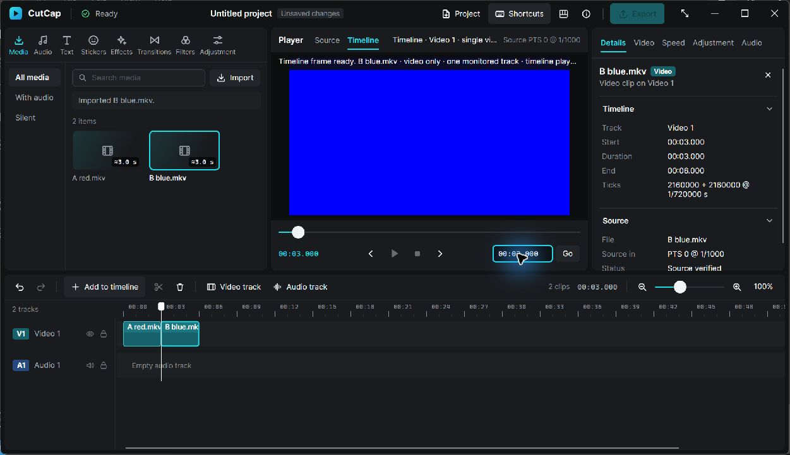
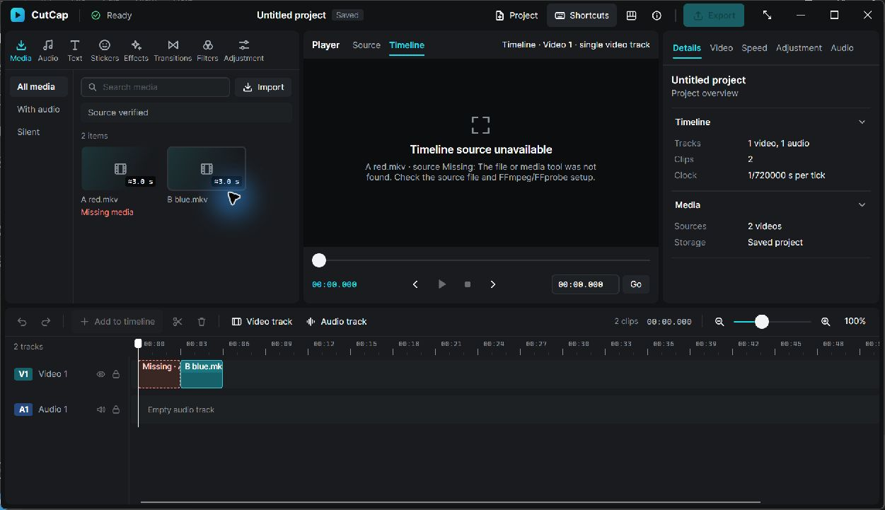

# Phase 3C — Exact timeline evaluation and real video preview

2026-11-06. Implemented and verified in the existing CutCap editor. Rust evaluates real clips and requests actual FFmpeg frames; the Avalonia Timeline tab, ruler and readouts use those results. Continuous timeline Play remains disabled.

## 1. Starting baseline and branch

Verified local HEAD **eca2b0e68194fd65bd96197d1be3f24812bd2235** against `git ls-remote origin refs/heads/claude/phase-3b-timeline-editing` and fetched that branch. The checkout was clean; origin remained `https://github.com/ayzeeyan/cutcap.git`. Created **codex/phase-3c-timeline-preview** directly from that commit. No history rewrite, force push or main merge.

Read AGENTS/CLAUDE and the architecture, ABI, project format, UI/engine contract, roadmap, Phase 3A/3B reports and actual producer/consumer/model code. The unmodified baseline passed all nine verify.ps1 stages: **86 Rust and 68 .NET tests**, builds and self-contained Windows publish. Sole developer for this milestone; no Claude coordination dependency or concurrent changes.

Environment: Windows 11 x64, Core Ultra 7 255H, integrated Intel Graphics/DX12 driver 32.0.101.9150, 16 GB RAM, 1920×1200 at 150% scaling. Rust/MSVC 1.99.1, actual .NET SDK 10.0.403 (global.json requests 10.0.401/latestFeature), Avalonia 12.1.5, external FFmpeg/FFprobe 9.0.1 essentials/Gyan. No system tool or dependency was installed/upgraded.

## 2. Implemented evaluation architecture

`cutcap-core/src/timeline.rs` provides a derived per-video-track sorted index, selected-clip→track lookup, half-open lookup and exact source mapping. The owner lazily builds the index after geometry edits/Open and performs binary lookup on seeks. Audio tracks are excluded. Monitoring policy: selected video track, else selected clip's video track, else first video track in project order. No compatible track means Blank. The viewer identifies this one track; nothing composites stacked tracks.

`Engine::evaluate` returns a small TimelineEvaluated result: project identity, independent transient model-generation UUID, document revision, exact position/timebase, monitored track, extent, active clip/media, mapped source request/end and status/error. It does **not** build a ProjectSnapshot. The UUID is independent of revisions that undo/redo may restore. Index invalidation and source availability are owned by Rust.

The session retains one desired seek and one in-flight evaluation. Rapid input replaces the desired slot. Mutations, track/clip selection, relink, project adoption (including the same ProjectId), mode changes and cancellation invalidate incompatible request/model identities. Selected-clip view lookup is cached, removing the previous clip scan during ordinary preview view updates. Clip data still uses Phase 3B's separate timeline document; seeks neither regenerate it nor change its generation.

## 3. Exact timing and boundaries

Clips cover **[timeline_start, timeline_end)**. The next adjacent clip owns the exact cut; gaps/end regions are explicit Blank and launch no decoder. Authoritative positions are i64 project ticks; SourceTime remains signed with its own rational clock. UI milliseconds/pixels are presentation inputs only. Native exact-tick seek and the `ticks` text suffix address sub-millisecond boundaries.

Mapping combines `source_in + (position-start)*project_timebase` exactly, then ceilings **once** into the stream clock. Quotient/remainder rational addition avoids the oversized numerator of a naive common-denominator product. Checked arithmetic handles conversion/addition/overflow. Signed/nonzero source offsets are preserved. Positions that cannot fit the signed millisecond display range are rejected before changing the owner position.

The exclusive source endpoint is the ceiling of `source_in + duration`. Returned actual PTS must rescale exactly to original stream ticks, be at/after the request and remain strictly below that endpoint. No nominal-FPS timestamps are generated. A finer-clock fractional PTS is rejected rather than rounded across the endpoint.

This retains the existing **ceiling frame-selection policy**. For VFR PTS 200/700, a 201 ms request in a clip ending at 600 ms finds 700 but rejects it: NoFrame inside this clip, with a blank picture. It does not hold 200, show the next clip, fabricate PTS or call the gap a decoder failure. This is a deliberate still-seek limitation; presentation-interval/hold semantics for continuous playback require a later explicit contract.

## 4. Decoder integration and ownership

Reused the existing isolated LatestDecoder and FfmpegBackend; no second decoder implementation, codec bindings or GPU path. Source and Timeline still-frame work share that worker's active/pending/completed bounds. Timeline receives the evaluated MediaSummary/SourceTime, then validates project/media/request identity and range before presentation. Old successes/errors cannot replace a newer mode/model/seek.

The native source cache and at most one timeline image can coexist, each <=3,686,400 RGBA8 bytes. The persistent source worker retains its existing bounded preroll when paused. There is still **one frontend FrameView/WriteableBitmap** and no frame array in JSON/MVVM. One session counter tags both modes; restoring a cached source frame renews its exposed generation. Copy permissions reject incompatible generations immediately. Existing process limits, cancellation/reaping and source scheduling deadlines are unchanged.

## 5. Source/Timeline separation

Rust owns mode and timeline position as transient state. Leaving Source pauses its transport, preserving position/epoch/preroll; returning restores the source view without auto-play. A source selected while hidden is decoded when visible rather than stealing the timeline request. Source transport calls retain Source-only semantics; Play/Stop reject while Timeline is monitored. Timeline Play is visibly disabled.

Source playback never moves the timeline playhead. Timeline seeks never dirty the document or enter history. Edits/undo/redo/relink invalidate evaluation while preserving authoritative model/persistence behavior. Open clears transient selection/history/position as documented; it does not serialize any index, image or monitor state. Format/core schema remain **1**.

## 6. ABI and managed interop

ABI/CONTRACT_VERSION **4→5** on both sides. Added set_preview_mode, seek_timeline (exact ticks), seek_timeline_ms, seek_timeline_text and cancel_timeline_preview. Consumed DTOs add preview_mode and timeline_preview with engine position/readouts, track, state, boundaries, requested/actual PTS and diagnostics. FrameInfo stays **24 bytes**; status numbers, opaque registry handles, SafeHandle/panic/buffer ownership and prior exports remain intact.

Managed EngineSession adds those typed controls and diagnostic view-byte/timeline-read counters. None evaluates clip semantics. See [NATIVE_ABI.md](NATIVE_ABI.md) and [the binding contract](PHASE_3C_TIMELINE_PREVIEW_CONTRACT.md).

## 7. Avalonia integration

Enabled the existing Timeline tab, retained Source mode and reused the bitmap presenter. Slider/go-to/step controls route to the active monitor; timecodes/input text come from Rust. Ruler click-to-seek switches to Timeline; the ruler and lanes draw the Rust position. Playhead-only updates invalidate drawing without rebuilding geometry or clip collections. Timeline state distinguishes evaluating/loading, ready, blank, missing/unavailable, no valid frame, failure and cancellation.

Preserved charcoal/cyan styling, zoom/scroll, project/inspector behavior, list identity, source shortcuts and text-field editing. Normal and minimum geometry were inspected at 150%. Minimum inspection found a local IsVisible binding overriding the narrow-caption style; wrapping the visibility binding restores space for the monitored-track name. The held diagnostic window confirmed the real red frame, visible Video 1 identity and working ruler at the minimum properties (960×600; captured window including extended chrome about 963×631). No screen-reader/other-monitor/DPI certification is claimed.

## 8. Actual test results

Final [structured verification](measurements/phase3c-verification.json). All final gates below exited **0**; raw local logs remain ignored under .artifacts/phase3c and .artifacts/verification.

| Command/check | Actual outcome |
|---|---|
| ./scripts/verify.ps1 | All nine stages pass |
| cargo fmt --all -- --check | Pass |
| cargo clippy --workspace --all-targets -- -D warnings | Pass, no warnings |
| cargo test --workspace | **96 passed**, 13 default-ignored (external/explicit measurements/subprocess helpers) |
| cargo build --workspace; cargo build --release | Pass |
| dotnet build CutCap.slnx -c Debug -nologo | Pass, no warnings/errors |
| dotnet test CutCap.slnx -c Debug -nologo --no-build | **74 passed**: desktop 37, interop 37 |
| dotnet build CutCap.slnx -c Release -nologo | Pass, no warnings/errors |
| dotnet publish apps/CutCap.Desktop/CutCap.Desktop.csproj -c Release -r win-x64 --self-contained true -o artifacts/publish/win-x64 -nologo | Pass |
| cargo clippy --workspace --all-targets --all-features --locked -- -D warnings | Pass |
| cargo test --workspace --all-features --locked | Pass |
| cargo test -p cutcap-media --test ffmpeg_integration -- --ignored --test-threads=1 | **7/7 pass** |
| cargo run -p cutcap-ffi --features gpu-diagnostics --bin cutcap-gpu-info | Intel integrated DX12/Microsoft CPU adapters enumerated |
| Release indexed_evaluation_cost_and_response_size explicit measurement | Pass; 2/5,000/50,000 clips, 2,000 samples each |
| Native timeline diagnostic / minimum inspection | Exit 0; real frames and cleanup |
| git diff --check | Clean |

New Rust/.NET coverage includes exact starts/ends/cuts, unsorted project-order indexing, gaps, empty/selected/audio-fallback tracks, source/project clock differences, nonzero/negative rational PTS, single-rounding fractions, short clips, sparse VFR endpoint rejection, invalid/overflow positions, generation/copy rejection, mode changes during decoding, latest seeks, active removal/undo/redo, saved clips, same-project Open, missing/relinked sources and non-dirty seeks. Real interop tests compare CFR/VFR/offset PTS with **independent FFprobe -show_frames**, and inspect decoded red/green pixels. Existing Phase 3B/P2 suites were retained.

One earlier full run failed the existing fast-child exit assertion; the targeted strict rerun, final full suite and all-features suite passed. Its assertion now includes the actual error for diagnosis; expected exit code, limits and timeout were not weakened. No remote CI success is claimed. Negative-start arithmetic is tested; negative-start media decoding was not separately validated.

## 9. Native Windows evidence

Actual mouse/keyboard/file-picker operations in the existing Debug/Release/published app:

- Imported two real, visually distinguishable synthetic FFV1 videos (red A, blue B, 320×180, 4 fps, 3 s). Added sequentially to Video 1: exact starts 0 / 2160000 and durations 2160000 ticks each.
- Switched Source→Timeline. Ruler seek to 1.466 s showed red A with actual source PTS 1500. Entering **2160000 ticks** showed blue B at source PTS **0**, exactly the cut. Seeking 4.5 s showed B source PTS 1500.
- Removed active B at 4.5 s: picture cleared to Blank. Toolbar Undo restored blue; Ctrl+Y removed it; Ctrl+Z restored it. Media files/assets remained.
- Source mode restored B at its independent position; Space advanced Source to 2 s while the timeline stayed 4.5 s. Returning Timeline restored 4.5 s, with Play disabled.
- Saved through the native picker, closed, reopened and repeated A/B evaluation. Both clips/reference ordering recovered. Seeking the empty 7.9 s region cleared the picture and the document stayed **Saved**.
- Renamed the owned A fixture, reopened the same project: both clips retained; A drawn missing and the Timeline viewer explicitly unavailable/blank. Relinked the original content through the Project menu: same clip/media identities, restored red frame at zero, dirty only for changed path. Saved and closed successfully.
- Minimum-size native inspection displayed a real evaluated frame in a 5,000-clip project; ruler seek changed 1.250→1.466 s without dirtying. The track label remained readable after the responsive fix.
- The normal diagnostic observed a live FFmpeg PID with timeline state Loading, then closed the actual editor window. Process exited 0; no CutCap/diagnostic/FFmpeg/FFprobe processes remained after cleanup.





Additional real screenshots: [A](images/phase3c-clip-a.jpg), [B](images/phase3c-clip-b.jpg), [blank after removal](images/phase3c-gap-after-removal.jpg), [source independence](images/phase3c-source-independent.jpg), [reopened B](images/phase3c-reopened-b.jpg), [relinked A](images/phase3c-relinked-timeline.jpg), [minimum](images/phase3c-minimum.jpg). No generated mockups. Other DPI/monitors, screen readers, long sessions and negative-start native media were not tested.

## 10. Performance measurements

[Sanitized measurements/method](measurements/phase3c-timeline-preview.json). Release build on the workstation above; synthetic sources and warm/uncontrolled OS caches/power/workload. Distinct FrameView.DrawImage callbacks are **not physical screen presentation**. Diagnostic process sampling and hooks add overhead. No continuous timeline FPS claim.

| Owner-only index benchmark | First index+evaluation | Cached p50 / p95 | Result JSON |
|---|---:|---:|---:|
| 2 clips | 34 µs | 300 / 400 ns | 1,222 B |
| 5,000 clips | 393 µs | 300 / 400 ns | 1,233 B |
| 50,000 clips | 3,730 µs | 300 / 400 ns | 1,234 B |

Each cached row has 2,000 samples; fixture construction is excluded. Allocation/OS variation is visible in maxima (3.1/6.6/2.6 µs), not a hard latency guarantee.

| Actual editor, normal layout | Samples | Seek→render median / p95 / max | Owner eval median | Decode median | Last CPU timeline draw median / p95 |
|---|---:|---:|---:|---:|---:|
| 2 clips | 36 | 125.33 / 141.97 / 144.12 ms | 8 µs | 86.36 ms | 402.65 / 654.8 µs |
| 5,000 clips | 30 | 126.29 / 146.04 / 168.22 ms | 9 µs | 90.89 ms | 1,013.25 / 1,208.6 µs |

There were **zero clip-document rereads during seeks**. The ordinary view stayed <=4,057 bytes; the 5,000-clip timeline document was 1,673,914 bytes, fetched separately. Each displayed isolated seek had a distinct FFmpeg PID (36/30): this milestone reuses the adapter/worker, **not a persistent timeline decoding process**. Decoder startup/redecode dominates latency.

Sixteen same-turn rapid requests coalesced to the last target; ready latency was 128.61 ms with the correct final local PTS 250. This measures latest-slot coalescing; cancellation after an active process starts is covered by regression tests and the close-during-active-decode scenario.

Peak host working/private memory was 325.23/225.61 MiB; peak observed FFmpeg working set was 22.03 MiB. These are sampled separate peaks, not a rigorously simultaneous total or leak proof. Per-sample first/last memory is in the JSON; JIT/GC/cache effects remain uncontrolled. Maximum diagnostic dispatcher gap was 67.09 ms, including project adoption/index/geometry setup. CPU draw recording excludes compositor raster and can lag one render callback. No speed improvement, bounded physical presentation timing or production performance guarantee is claimed.

## 11. Known limitations

One monitored video track, no composition/audio/export/effects/timeline Play. Still requests retain ceiling selection, so a sparse-VFR/short tail can show NoFrame inside a nonempty clip. Timeline/source mode, position and indexes are transient. Source pauses on leaving and does not auto-resume. Isolated seeks restart FFmpeg; no timeline decoder continuity/prefetch was added. Source-frame cache plus one timeline frame adds a bounded native image; no redundant frontend image/cache.

Current model-update snapshots/clip-document rebuilding retain Phase 3B's O(n) editing cost; only seek evaluation/view lookup avoids clip scans. Very large viewport coordinates remain presentation approximations; exact ticks govern edits/evaluation. Source hash/path/persistence OS-call and durability limits remain those in PROJECT_FORMAT.md. Application licensing is still undecided; GPL-enabled FFmpeg remains an external owner-authorized development runtime and is neither bundled nor automatically cleared by subprocess use. No new dependencies or native binaries were added.

## 12. Commits and push

- **ec0849ece1bb8772cc6d60d6621c0ee0f226569b** — `feat(engine): evaluate exact timeline previews through ABI 5`
- **a583d80d6149c757f034cbf41e76edd1dfd91be8** — `feat(ui): enable single-track timeline preview and ruler seeking`
- **926c264d58c94405e47e30da383e132d2315b062** — `test(timeline): record native preview timing and recovery evidence`

`git push -u origin codex/phase-3c-timeline-preview` **exited 0**. GitHub acknowledged `[new branch] codex/phase-3c-timeline-preview -> codex/phase-3c-timeline-preview`, and local tracking was established through 926c264. This report is added in a subsequent conventional documentation commit and pushed on the same branch; final remote HEAD acknowledgment is recorded in the completion handoff. No force push, merge, PR creation or release publication. Staging review excluded machine-local logs, generated media, build outputs and credential patterns; only intentional source/docs/sanitized measurements/real editor screenshots were included.

## 13. Next milestone

Implement **video-only timeline playback across cuts** using this evaluator's track policy, source ranges and generation identity. Define cross-cut decoder handoff/prefetch, monotonic timeline clock, gap pacing, pause/seek/EOF and cancellation before adding a Play binding. Measure distinct rendered frames separately from decoded/copied counts, retain bounded resource ownership and the CPU path, and leave audio/compositing/export separate.

The local self-contained executable is artifacts/publish/win-x64/CutCap.exe. The owned native test project remains .artifacts/phase3c/native timeline.cutcap with its referenced mathematical-color fixtures. Those machine-local artifacts/logs are intentionally ignored.

## Exact changed-file inventory

```text
AGENTS.md
CLAUDE.md
DESIGN.md
PRODUCT.md
README.md
apps/CutCap.Desktop/Controls/TimelineLanes.cs
apps/CutCap.Desktop/Controls/TimelineRuler.cs
apps/CutCap.Desktop/ViewModels/MainWindowViewModel.cs
apps/CutCap.Desktop/ViewModels/PlayerViewModel.cs
apps/CutCap.Desktop/ViewModels/TimelineViewModel.cs
apps/CutCap.Desktop/Views/PlayerPanel.axaml
apps/CutCap.Desktop/Views/TimelinePanel.axaml
apps/CutCap.Desktop/Views/TimelinePanel.axaml.cs
crates/cutcap-contracts/src/lib.rs
crates/cutcap-contracts/src/messages.rs
crates/cutcap-contracts/src/timeline.rs
crates/cutcap-core/src/lib.rs
crates/cutcap-core/src/timeline.rs
crates/cutcap-core/tests/timeline_evaluation.rs
crates/cutcap-ffi/src/abi.rs
crates/cutcap-ffi/src/editing_tests.rs
crates/cutcap-ffi/src/engine.rs
crates/cutcap-ffi/src/evaluation_measurements.rs
crates/cutcap-ffi/src/lib.rs
crates/cutcap-ffi/src/media.rs
crates/cutcap-ffi/src/session.rs
crates/cutcap-ffi/src/tests.rs
crates/cutcap-ffi/src/timeline_preview.rs
crates/cutcap-ffi/src/timeline_preview_tests.rs
crates/cutcap-ffi/src/view.rs
crates/cutcap-media/src/process.rs
docs/ARCHITECTURE.md
docs/DECISIONS.md
docs/ENGINE_UI_CONTRACT.md
docs/NATIVE_ABI.md
docs/PHASE_3C_TIMELINE_PREVIEW_CONTRACT.md
docs/PHASE_3C_TIMELINE_PREVIEW_REPORT.md
docs/PROJECT_FORMAT.md
docs/ROADMAP.md
docs/SETUP_WINDOWS.md
docs/images/phase3c-clip-a.jpg
docs/images/phase3c-clip-b.jpg
docs/images/phase3c-exact-cut.jpg
docs/images/phase3c-gap-after-removal.jpg
docs/images/phase3c-minimum.jpg
docs/images/phase3c-missing-timeline.jpg
docs/images/phase3c-relinked-timeline.jpg
docs/images/phase3c-reopened-b.jpg
docs/images/phase3c-source-independent.jpg
docs/measurements/phase3c-timeline-preview.json
docs/measurements/phase3c-verification.json
src-dotnet/CutCap.Interop/EngineSession.cs
src-dotnet/CutCap.Interop/NativeMethods.cs
src-dotnet/CutCap.Interop/SessionView.cs
tests/CutCap.Desktop.Tests/TimelinePreviewTests.cs
tests/CutCap.Interop.Tests/TimelinePreviewTests.cs
tools/CutCap.PlaybackProbe/Program.cs
tools/CutCap.PlaybackProbe/TimelineProbe.cs
```
