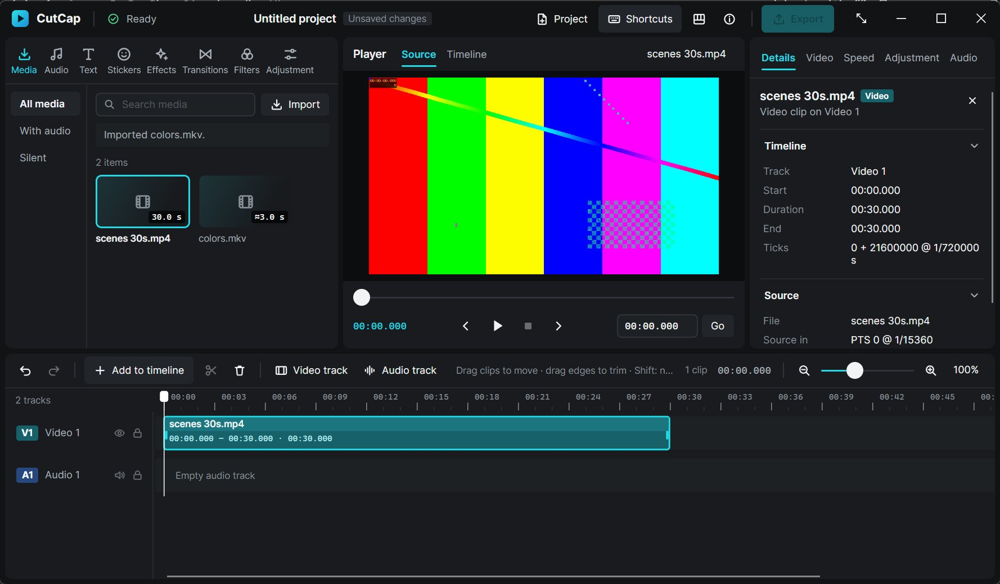
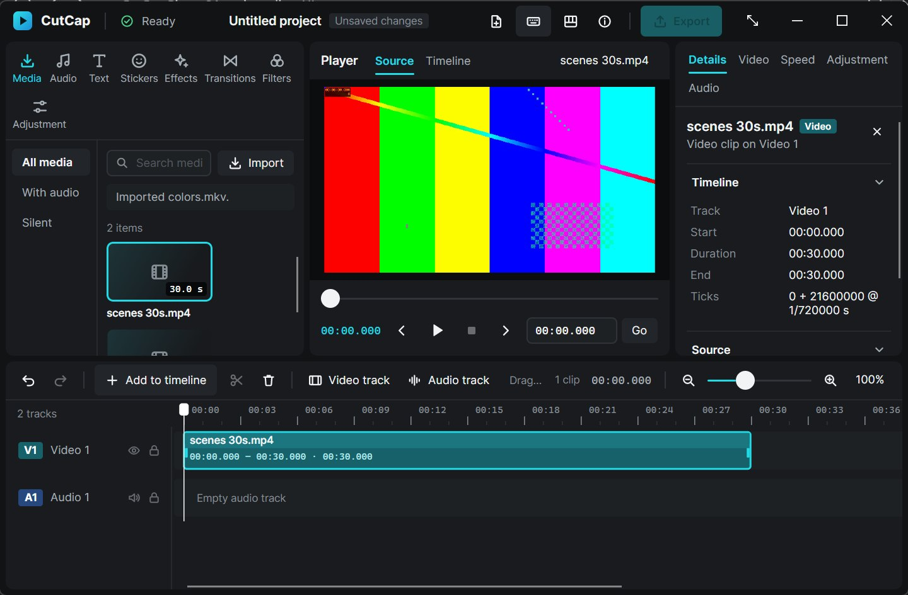
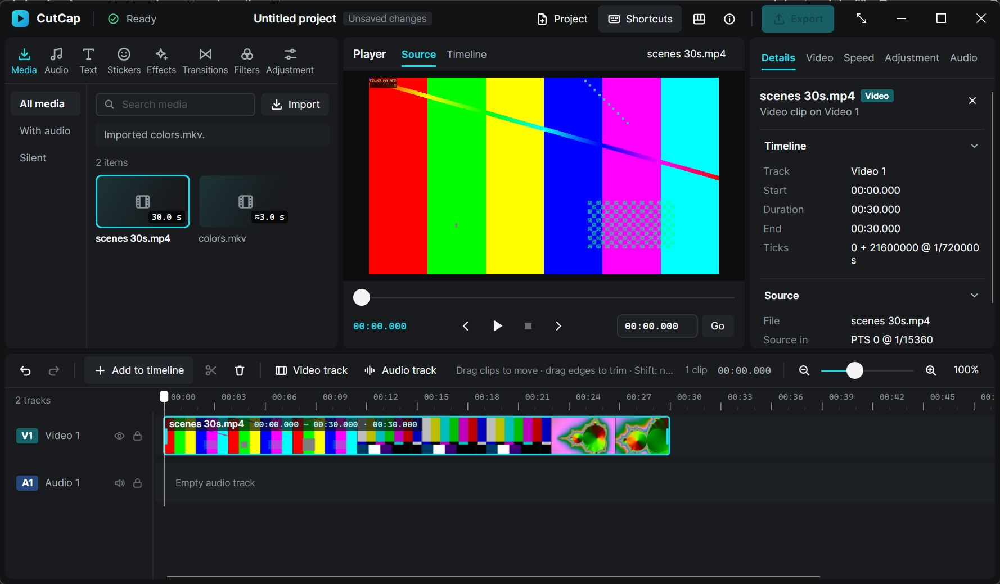
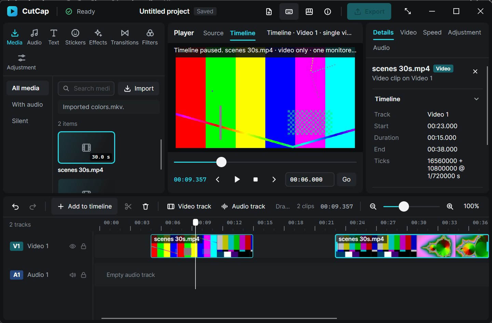

# Phase 4A — Real video filmstrips, thumbnail generation and timeline caching

Author: Claude Opus 5.5, sole active developer for this milestone (owner-directed).

## 1. Starting baseline

- Started from `origin/main` at `7a510d0` (the PR #3 merge: Phase 3E). Branch `claude/phase-4a-timeline-filmstrips` was created from it; `main` was not modified.
- Baseline verification before any edit, on `7a510d0`:
  - `scripts/verify.ps1`: all 9 stages exit 0;
  - 129 Rust tests;
  - 91 .NET tests (46 desktop, 45 interop);
  - FFmpeg integration 9/9.
- **Before:** clips were solid teal rectangles with a name and time label, in 50 DIP lanes. The "before" screenshots were captured from the unchanged Phase 3E publish build (engine without thumbnail exports, frontend without the filmstrip code), at normal and minimum size (§8).
- **Stale documentation corrected:** DESIGN.md still said "Timeline Play remains disabled", although it has been enabled since Phase 3D.

## 2. Thumbnail extraction architecture

```
TimelineLanes (C#, UI thread)
  └ PlanThumbnails: visible cells first, then 25 % overscan, ≤96 wants, 50 ms debounce
     └ EngineHost.RequestThumbnails → cutcap_session_request_thumbnails (ABI 8, JSON)
        └ Session.request_thumbnails (Rust): validate media/source_key, µs→ticks (ceil), past-end → no-frame
           └ ThumbnailService (1 worker thread): demand replacement, dedup, cancellation, throttle
              └ MediaBackend::thumbnails → FfmpegBackend::extract_thumbnails
                 (1 process per ≤6 samples of one source, below-normal priority, -threads 1)
EngineHost.Tick: pump → next_thumbnail/copy_thumbnail (≤16 per tick) → WriteableBitmap → ThumbnailCache (LRU)
TimelineLanes.Render: draws cached bitmaps only (no decode, no I/O, no image allocation)
```

- **Media (`crates/cutcap-media/src/thumbnail.rs`).**
  - `extract_thumbnails(media, height, batch, cancel)` validates the batch (1–6 samples, one timebase, positions inside the source) and the size. The height is clamped to 16–216 px; the width comes from the display aspect after rotation and sample aspect, capped at 384 px.
  - It launches one FFmpeg process with one keyframe-seeked input per sample.
  - It returns per-sample results: a thumbnail with its *actual* PTS, a no-frame result, or a failure. A failed batch never fabricates frames.
- **Engine session (`crates/cutcap-ffi/src/thumbnails.rs`, `session.rs`).**
  - The `ThumbnailService` owns one worker thread. A new demand replaces the previous one, and duplicates (queued, in-flight or waiting) are coalesced.
  - An in-flight batch whose samples are all unwanted is cancelled: the child is killed and reaped.
  - At most 64 completed results wait to be taken (checked per batch, so 64 + 6). The worker pauses until the UI drains them.
  - While playback runs, batches shrink to 2 samples with a 150 ms pause.
  - The session validates each want against the current snapshot and filters results by source key when announcing them. It clears the service when the project id changes, and stops it first on shutdown.
- **Interop and UI.**
  - ABI 8 adds three pull-based exports (§14).
  - `EngineHost` copies each thumbnail once into a new `WriteableBitmap` owned by the cache.
  - `TimelineLanes` plans and draws; `FilmstripLayout` is the pure geometry.
- **Project isolation.**
  - No thumbnail code touches `Project`, history, the document revision or saved files.
  - Tests check this at three levels: the session (history depth unchanged across thumbnail work), interop (document revision and Dirty unchanged after requests on a saved project), and native (the reopened project title stays clean while thumbnails regenerate).

## 3. Timestamp policy

- **Exact interval.** Clip rows carry the clip's exact source interval, computed in Rust from the core mapping (`map_clip_source`): `source_in_ticks` and the end-exclusive `source_end_ticks` in the stream timebase. They also carry `source_in_us` (ceiling) and `source_end_us` (floor) for layout.
- **Sample mapping.** A sample is requested in whole µs of source time. Rust rescales it to stream ticks with **ceiling** rounding and clamps it to `start_pts`. The thumbnail is the **first decoded frame whose actual PTS is ≥ that tick**, the same policy as the Phase 3C still preview. A cell therefore shows the frame on screen at the cell's left edge.
  - Nothing uses a nominal frame rate or a frame index.
  - The actual PTS comes from the branch's nonce-tagged `showinfo` record, which reports the decoder's own PTS with `-copyts`.
- **Acceptance in C#.** C# draws a decoded image only if `source_in_ticks ≤ actual < source_end_ticks`. A sample near the end of a part whose next frame belongs to the following clip keeps its placeholder; a successor frame never leaks backwards. The interop test asserts exactly this case.
- **Past the end.** A sample at or after the source end completes immediately as no-frame, without decoding.
- **Proven cases:**

| Case | Evidence |
|---|---|
| CFR | Samples at 0 / 0.1 / 1.1 / 2.1 / 2.75 s → actual 0 / 250 / 1250 / 2250 / 2750 ms, red/red/green/blue/blue pixels. Covered by the FFmpeg integration and interop tests. |
| VFR | PTS 700/700/1500/1500/2300 with matching colours. |
| Nonzero start | `start_pts` 5000. |
| Rotation | Rotated input yields a portrait thumbnail, aspect after rotation. |
| Trim/split | The split right part's first cell shows the 1.5 s frame (green). The trimmed left part's first cell shows the 0.75 s frame for an in-point of 0.6 s. |
| Fractional µs | 1250.5 ms → tick 1251 (ceiling), session test. |

## 4. FFmpeg process strategy

- One process per **batch of ≤6 samples** from one source at one height.
- Each sample is its own input: `-noaccurate_seek -seek_timestamp 1 -ss <t − 1 s> -i <file>`, with `-copyts`.
  - FFmpeg seeks to the keyframe before `t − 1 s` and decodes forward.
  - `select=gte(pts\,T)` then passes the first frame with actual PTS ≥ T, followed by `scale`, RGBA conversion, `showinfo@cutcap_<nonce>_<n>` and `trim=end_frame=1`.
  - The branches are joined with `concat` into one rawvideo RGBA stream at the thumbnail size, so pixels are read straight into the result without re-encoding.
- **Missing branches.** A branch that reaches EOF produces no frame and no tag, and is reported as no-frame. The tag uses a per-batch UUID nonce, and only stderr lines that *start with* the exact `[showinfo@cutcap_<nonce>_<n> @` prefix are parsed, so stream metadata cannot forge a PTS (unit test).
- **Resource limits.**
  - The process runs with `BELOW_NORMAL_PRIORITY_CLASS`, `-threads 1` on **every input**, and `-filter_threads 1`, inside the existing per-child job object (1 GiB commit limit, kill on close).
  - It obeys the same cancellation, timeout and reaping paths as the decoder.
  - A batch at most 6 × 384 × 216 × 4 bytes in size (about 2 MiB).
- **Alternatives rejected:**
  - one process per thumbnail, which costs 6× the launches and decoder setups;
  - a persistent seeking decoder, which is a new media protocol;
  - linking FFmpeg libraries, which raises licensing and packaging questions (ADR 006/008).
- **Thread-placement defect.** The first native performance run showed thumbnails competing with playback. Investigation found that `-threads` is a *per-input* decoder option. Given once, it applied only to the first input, and the other five decoded with automatic threading.
  - Measured with the CLI on the 1080p GOP-250 source (`docs/measurements/phase4a-playback-startup.json`):

    | Threads option | Wall time per batch of 6 | CPU time | Average cores |
    |---|---|---|---|
    | Given once (first input only) | 1.8–1.9 s | 4.4–5.4 s | about 2.7 |
    | Given before every input | 3.4–3.7 s | 3.9–4.1 s | about 1.1 |

  - The option is now given before every input. This trades about 2× batch latency for a bounded single-core background load, which is the stated design.
- **Per-sample cost.** It is dominated by decoding from the previous keyframe. On short-GOP media (the test fixtures) a 3-sample batch takes about 0.1 s; on the long-GOP 1080p source a 6-sample batch takes 2–3.5 s (§11).

## 5. Cache design

- **`ThumbnailCache` (C#, UI thread only).**
  - Key: (`source_key`, sample µs, pixel height).
  - Least-recently-used eviction by **resident pixel bytes**.
  - Default budget 48 MiB, overridable with `CUTCAP_THUMBNAIL_CACHE_MB`, minimum 1 MiB. At 150% scaling the strip is `round(43 × 1.5)` = 64 physical px, so a 16:9 thumbnail is 114 × 64 px (28.5 KiB) and 48 MiB holds about 1,700 thumbnails, many screens of filmstrip.
- **Bitmaps.** Each decoded thumbnail becomes one `WriteableBitmap`, reused for every draw and disposed exactly once on eviction, replacement or shutdown (unit-tested with a disposal-counting fake).
- **Negative results.** No-frame and failed results are remembered without bytes, so they are not retried for the same key (an entry-count cap of 20,000 still bounds them).
- **Tokens.** Pending tokens are stable per key while demanded. `RetainPending` forgets undemanded tokens, and a late result for one is disposed instead of cached.
- **Why a grid makes the cache effective.** Samples sit at fixed source times for a zoom, so scrolling back, moving a clip, undo/redo and split parts all hit the same keys. A zoom change asks for a new grid, and the previous zoom's images remain cached until evicted.
- **No disk cache.** It is optional in the brief and was not built: it would need invalidation, privacy rules (no source paths in file names) and cleanup policy, for data that regenerates in seconds from local media. Nothing is written to disk.

## 6. Invalidation and budgets

| Event | Effect |
|---|---|
| Scroll / zoom / viewport resize / edit | Re-plan after 50 ms; the new demand replaces the old one; unwanted queued samples are dropped; an in-flight batch nobody wants is cancelled. |
| Trim / split / move / undo / redo | New clip rows → new cells on the same grid; cached samples are reused; frames outside a part's new interval are not drawn. |
| Relink | `source_key` changes (path hash). Old-key wants are rejected, old-key results are discarded when announced, and old images are never looked up again. |
| Missing / unverified / changed media | `source_key` is empty: nothing is requested and no images are drawn (dashed missing style). |
| New / Open project | The Rust service is cleared (batch cancelled) and C# pending tokens are voided. Decoded images stay keyed by source, so reopening the same file reuses them. |
| Playback active | Batches of 2 and a 150 ms pause; the playback decoder keeps priority. |
| Shutdown | The thumbnail service stops first (cancel, kill/reap, join), then the media workers. |

Budgets:
- 128 wants per request at the ABI (C# sends ≤96);
- 64 KiB request JSON;
- 6 samples per batch;
- 64 (+6) completed results waiting;
- 16 copies per UI tick;
- the 48 MiB RAM cache;
- at most one thumbnail FFmpeg process at a time.

## 7. Avalonia rendering

- **Lanes.** Video lanes grew from 50 to 56 DIP (track headers match) so a 43 DIP strip fits.
- **Cells.** Cell width is strip height × source display aspect, so frames are never stretched. The last cell is cropped at the clip end using a source-rect crop rather than scaling.
- **Draw order:**
  1. the clip fill;
  2. each cell, either its bitmap or a flat placeholder (`#1B5960`);
  3. thin dividers;
  4. a translucent name band behind the label only;
  5. outline and trim grips last.
- **Missing clips** keep the Phase 3B dashed coral style with no images. Clips narrower than 12 DIP draw only the fill.
- **Render cost.** Render draws only: it looks up the cache (dictionary plus LRU touch), never decodes or reads files, and allocates no images. Cells are laid out only for the visible window, reusing one list.
- **Planning** runs off a 50 ms debounce after scroll, zoom, clip, lane or viewport changes, and after thumbnails arrive (to request what is still missing). It never runs in Render.
- **Thumbnail size** is chosen in physical pixels (strip height × render scaling), so images are crisp at 150%.

## 8. Screenshots

All screenshots are genuine captures of the CutCap window (client area only) at **150% display scaling**. They were taken by the native scripts while CutCap owned the foreground. The sources are generated: `scenes 30s.mp4` is three 10 s scenes (testsrc2, SMPTE bars, Mandelbrot), 1280×720 H.264; `long 1080p.mp4` is testsrc2 1920×1080 at 30 fps with GOP 250, 180 s.

| Image | What it shows |
|---|---|
|  `phase4a-before-solid-clips.jpg` | **Before:** Phase 3E publish build, same source and placement, a solid teal clip in a 50 DIP lane |
|  `phase4a-before-minimum.jpg` | **Before:** Phase 3E build at the minimum window (1440×900 physical = 960×600 DIP) |
|  `phase4a-filmstrip.jpg` | **After:** the 30 s clip at 100%, three distinct scenes in order, a 56 DIP lane |
|  `phase4a-minimum.jpg` | **After:** the minimum window, with the split parts and the moved part (23–38 s) |
| `phase4a-zoom-200.jpg` / `phase4a-zoom-50.jpg` | Denser cells at 200%; fewer, wider-spaced samples at 50% |
| `phase4a-scrolled-away.jpg` | 0.8 s after 25 wheel ticks right: the newly visible cells are already filled (25% overscan prefetch), and the name band follows the visible clip start |
| `phase4a-trimmed.jpg` | Start trimmed by 5 s: the strip begins at source 5 s (a partial first cell at the in-point) |
| `phase4a-split.jpg` | Split at 15 s: the left part ends in scene 2, the right part starts on scene 2 at source 15 s |
| `phase4a-moved.jpg` | The right part moved to 23 s: identical frames, new position |
| `phase4a-timeline-playing.jpg` | Timeline playback running with filmstrips drawn |
| `phase4a-missing.jpg` / `phase4a-relinked.jpg` | Source renamed: dashed "Missing" clips with no images; after relinking, frames return |
| `phase4a-1080p.jpg` | The 180 s 1080p source at 100% (performance run) |
| `phase4a-5000-clips.jpg` | The generated 5,000-clip project (Release build): every clip shows its real first frame from one shared cached sample, and the title stays "Saved" |

## 9. Automated tests

| Gate | Result |
|---|---|
| `scripts/verify.ps1` | **All 9 stages exit 0**: fmt, clippy `-D warnings`, cargo test, debug/release builds, .NET Debug build/test, Release build, win-x64 self-contained publish. 0 warnings. |
| `cargo test --workspace` | **139 passed** (baseline 129), 19 ignored (baseline 16; +3 FFmpeg thumbnail tests that run below) |
| `dotnet test CutCap.slnx` | **103 passed** (baseline 91): desktop 54 (+8), interop 49 (+4); 1 explicit measurement test runs separately |
| `cargo test -p cutcap-media --test ffmpeg_integration -- --ignored --test-threads=1` | **12 passed** (baseline 9) |
| `cargo clippy --workspace --all-targets --all-features -- -D warnings` | clean |
| `git diff --check` | clean |

**New tests:**
- **Media unit tests** (`thumbnail.rs`):
  - showinfo branch parsing, including a forged `title:` tag line that must be ignored;
  - thumbnail sizing, including rotated portrait sources and the clamps.
- **FFmpeg integration** (`ffmpeg_integration.rs`), real pixels and PTS:
  - CFR samples map to the first actual frame ≥ the sample, with the expected red/green/blue pixels, and a past-end sample gives no frame;
  - VFR PTS 700/1500/2300, a 5 s start offset, and rotation keeping portrait output;
  - bad batch, timebase and position are rejected, and cancellation is honoured promptly.
- **Engine session/ABI** (`thumbnail_tests.rs`, 8 tests):
  - demand replacement, dedup and cancellation of unwanted batches;
  - throttled batch size and backpressure bound (64 + 6);
  - clear and shutdown during a running batch;
  - clip rows carrying the exact source interval through trim, split and move, without changing history;
  - want validation, delivery by token, ceiling mapping (1250.5 ms → 1251), and view stats republished;
  - stale results across new project, missing source and relink;
  - ABI argument validation;
  - an ABI round trip: 71×40, stride 284; a rejected destination keeps the thumbnail announced.
- **Interop with real FFmpeg** (`ThumbnailTests.cs`):
  - real thumbnails carry actual PTS and pixels without changing a saved document's revision or Dirty state;
  - split and trim rows bound each filmstrip to its own interval: the successor frame is *not* accepted for the left part;
  - results for a relinked or replaced source are never delivered;
  - oversized and malformed demands are rejected at the boundary;
  - plus the explicit start-up measurement.
- **Desktop** (`FilmstripTests.cs`, 8 tests):
  - a fixed source grid reused by moves, splits and scrolls;
  - visible-window-only layout;
  - step and zoom density, short clips;
  - source-interval acceptance;
  - negative results and undemanded tokens;
  - LRU byte budget with exact disposal;
  - visible-first planning that skips cached and unavailable clips;
  - a 5,000-clip plan limited to the viewport, in 214 µs.

## 10. Native Windows verification

**Script.** `scripts/native-ui/filmstrip-ui.ps1` drives the real Debug app (Windows 11, 150% scaling, 1800×1050 window) with synthetic input, only while CutCap owns the foreground. Log: `docs/measurements/phase4a-native-scenario.txt`.

**Pixel oracle.** Each checked cell is verified by real pixels. The mean RGB of the cell's lower area on screen (below the name band) is compared with the same sub-rectangle of a frame decoded *independently* by the FFmpeg CLI at the same sample (`select=gte(pts, ceil(sample))`). The pass threshold is a distance below 40, against roughly 49 between neighbouring scenes.

| Step(s) of the brief | Result |
|---|---|
| 1–2 Import a source with visually different scenes; place it | `scenes 30s.mp4` placed in 263 ms (acceptance) |
| 3–4 Multiple real frames that differ by content | Cells k=0 / 3 / 6 (0 s, 11.467 s, 22.933 s; one per scene) match the oracle at distances 5.8 / 0 / 3.6; scenes 1 and 2 differ by 49.1 |
| 5–6 Zoom in and out | Denser cells at 200%, sparser at 50% (screenshots) |
| 7–8 Scroll away and back | 25 wheel ticks right: the k=0 position no longer shows that frame (distance 181.4, required > 40, which proves the view moved). 40 ticks back: cells k=0 and k=3 match again (5.8 / 0) at the first check, 300 ms after the last tick. These samples were cached at placement |
| 9–10 Trim the start by 5 s | Lanes show `00:05.000 to 00:30.000`; first grid cell (7.644 s) matches at 1.4 |
| 11–12 Split at 15 s | Left cell matches at 1.4, right part's 15.289 s cell at 1.0 |
| 13–14 Move the right part to 23 s | Same frames at the new position (1.0) |
| 15 Undo / redo the move | 231 / 234 ms, strip follows |
| 16–17 Save, close, reopen | Close in 670 ms, no leftover processes. Reopened in 220 ms, the title stays clean (no `*`) while thumbnails regenerate, and the reopened cell matches at 1.4 |
| 18–19 Missing media, then relink | Renamed source: dashed "Missing" clips, no images. After relinking via Project ▸ Relink, the cell matches at 1.4 and the saved title is clean |
| 20 Timeline playback with filmstrips | Playing (Pause shown), frames advancing |
| 21–22 Close while thumbnails decode | Zoom (new grid), then close at once: exited in 648 ms, exit code 0, no CutCap/FFmpeg/FFprobe processes left |
| Minimum window | 1440×900 physical (960×600 DIP): filmstrips, headers and toolbar intact |

**Defects the native runs found and fixed:**
- **Script logging.** The script's `Note` used `Write-Output` inside functions, so the per-cell results never reached the console (they were still recorded in `$log`). It now uses `Write-Host`.
- **Scroll-back evidence.** The scroll-back check originally only re-matched the cells, which would also pass if the view had never moved. It now requires a mismatch after scrolling away.
- **Unsaved-prompt timeout.** The first full run's close-during-decode step timed out at 10 s. Relinking is a document edit, so CutCap correctly asked about unsaved changes. The script now saves after relinking, so the step measures shutdown alone.

**Regression scenarios:**
- The Phase 3E editing scenario (`timeline-edit-ui.ps1`) was rerun with 56 DIP lanes. Lane hit points moved to the lane centre in `timeline-edit-ui.ps1`, `timeline-ui.ps1` and `timeline-draw.ps1`. It passed every step: drag/drop, overlap and audio-lane rejection, snapping, trims, split, timeline playback across the cut, save, reopen (the file is identical: `identical=True`), source playback, and close during source decoding (645 ms, no leftovers).

## 11. Performance

**Setup.**
- Machine: Windows 11, Intel Core Ultra 7 255H (16 cores), integrated graphics, 16 GB RAM, 150% scaling.
- Debug app build with `CUTCAP_TRACE_THUMBNAILS=1` (opt-in, off by default).
- Source: the 180 s 1080p H.264 file with **GOP 250** (8.3 s between keyframes), a deliberately costly case for seeking.
- Run by `filmstrip-ui.ps1 -Perf` and summarised by `filmstrip-perf-report.ps1` into `docs/measurements/phase4a-filmstrip-performance.json`.
- Times are measured from the scripted input, so they include UI input latency. A viewport is 13–15 cells at 100%.

| Phase | Demands | Time to fill (no placeholders left) | Notes |
|---|---|---|---|
| Place the clip (cold) | 3 | first image 2.98 s, filled **8.1 s** | 17 thumbnails; batches of 6 take 2.6–3.0 s each on this source |
| Zoom to 200% | 5 | filled 6.0 s | New grid: unchanged samples (e.g. 0 s) draw at once |
| **Back to 100%** | **0** | **0 placeholder renders** | Every cell came from the cache: no FFmpeg work |
| Scroll to the clip end (2,855 px) | 3 | filled 9.9 s | 53 renders with placeholders while scrolling, never blank lanes |
| Zoom to 50% | 5 | filled 11.4 s | Samples 8.6 s apart, each a separate keyframe seek |
| Timeline Play while 14 thumbnails are pending | 6 | — | **30.0 fps copied, 0 dropped**; thumbnails throttled to 2 per batch (1.1–1.4 s each) |
| Timeline Play with all cached | 0 | — | 30.0 fps, 0 dropped |
| Close during decoding | — | — | exited in **717 ms**, 0 leftover processes |

**Process launches.** There were 23 FFmpeg batches for 75 delivered thumbnails, and 4 batches were cancelled because the view moved on. Completed batches averaged about 3.9 thumbnails per launch; throttled playback batches carry 2. There is at most one thumbnail process at a time.

**Memory.**
- The cache held 75 thumbnails in 2.1 MiB (about 28.5 KiB each), with 0 evictions under the 48 MiB budget.
- Peak managed heap was 31 MiB. The whole app's working set peaked at 388 MiB; that figure includes 1080p preview and playback frames.
- FFmpeg batch output is bounded at 6 × 384 × 216 × 4 bytes.

**UI-thread cost** (draw-call recording, not GPU raster or presentation):
- **Lanes render** with one long filmstrip: 207–520 µs average and ≤ 843 µs max per phase. The highest was 2.6 ms, the first render after placement, which includes JIT.
- **Planning:** 95–184 µs average (the first plan was 1.2 ms).
- **Bitmap copies:** 0.2–1.2 ms per drain, capped at ≤ 16 per tick.

**Cache effectiveness.** The trace counted 2,375 hits against 1,547 misses. A miss here is a lookup for a cell whose image has not arrived yet, i.e. a placeholder frame. Zooming back, resuming playback and pausing produced no new demand.

**Start-up and playback impact.** These come from the controlled engine measurement (`docs/measurements/phase4a-playback-startup.json`), with real FFmpeg and no UI.
- Timeline Play → Playing at the same positions, with and without a 6-sample thumbnail batch in flight, differs by −99 to +241 ms with no consistent sign.
- A first play in a fresh session at 5 s took 2.18–2.34 s either way.
- Start-up is dominated by decoding from the previous keyframe: 0.8–3.8 s on this GOP-250 source.
- The native trace shows 4.3 s for the session's first play against 1.0 s for a later one at the same position. The later play resumed warm decoders; the engine measurement shows the gap is not caused by thumbnails.

**Before the thread fix (§4)** (`phase4a-filmstrip-performance-before-thread-fix.json`), batches were about 2× faster in wall time but used about 2.7 cores each. The fix halves the background CPU at the cost of slower fills on long-GOP sources. Sources whose samples sit nearer to keyframes fill much faster. In the native scenario, the three checked cells of the 1280×720 source showed their real frames when checked about 6 s after placement (the script waits 4 s, then checks). The short fixture batches take about 0.1 s.

**5,000 clips** (`docs/measurements/phase4a-draw-5000-clips.json`). The same `timeline-draw.ps1` script was run on the Release publish of each build, 18 visible clips per render:

| Build | Average draw-recording time per render | Single-render outliers |
|---|---|---|
| Phase 3E | 1.77 / 1.30 ms | up to 17.8 ms |
| Phase 4A | 1.63 / 2.22 ms | up to 18.2 ms |

The two builds overlap, so no filmstrip-specific cost is distinguishable from run-to-run variance in this trace. A Debug run before two render fixes was slower (2.59 / 1.87 ms). The fixes were one visual-tree scaling lookup per render instead of per clip, and a rectangular rather than rounded clip.

**Not claimed.**
- Smooth 60 fps scrolling is not claimed: frame pacing and compositor presentation were not measured, only UI-thread draw-recording time.
- The return-scroll cache hit was not measured by wheel because of the pre-existing scroll issue in §13. The zoom-back phase demonstrates the same cache path.

## 12. Regression results

- **Source and timeline playback.** These are unchanged in contract. The Phase 3D/3E interop suites pass (§9). In the native runs, timeline playback with filmstrips reached a steady 30 fps with 0 dropped frames. Cold-start latency is unchanged by concurrent thumbnail work (§11).
- **Editing.** The Phase 3E native editing scenario passes on 56 DIP lanes (§10): placement, moves, trims, split, snapping, rejections, undo/redo, save/reopen with an identical file. Desktop geometry tests use the lane constants instead of a hard-coded 50 px.
- **Persistence.** Thumbnail work never changes the document. The session test checks history depth, the interop test checks revision and Dirty on a saved project, and the native run checks the title after reopen.
- **Shutdown.** The app closes during thumbnail decoding in 635–717 ms across all runs, with no CutCap, FFmpeg or FFprobe processes left. The Rust test `clear_and_shutdown_cancel_a_running_batch_promptly` covers cancellation of a running batch.
- **Layout.** Lanes are 6 DIP taller per track. The timeline area is unchanged (42% of the workspace, minimum 170). At the minimum window two tracks remain fully visible (screenshot).

## 13. Known limitations

- **No disk cache.** Thumbnails regenerate per app session (seconds for a viewport).
- **Seek cost depends on GOP length.** Each sample decodes from the preceding keyframe. Long-GOP sources cost more per batch, and there is no proxy or keyframe-index reuse yet.
- **Single-sample policy.** One frame per cell (its left edge), not an average. A cell spans many frames at low zoom, as in other editors.
- **No zoom fallback.** A zoom change requests a new grid; until it arrives, cells show placeholders rather than reusing images from another zoom.
- **Fixed preview height.** Thumbnails are requested at the lane's physical strip height; there is no per-monitor re-request beyond what the next plan does after a DPI change.
- **Video only.** Audio lanes and waveforms are out of scope.
- **Pre-existing wheel-scroll lock, not caused by this phase.**
  - On a long timeline (the 180 s clip), synthetic wheel input after the first burst has no effect in either direction. This happens with both Shift+wheel and horizontal-wheel events: the lanes stayed at offset 1500, or at 2855 when the first burst reached the end.
  - On the 30 s clip, repeated bursts scroll back and forth normally.
  - The identical probe on the **Phase 3E publish build** shows the same lock, so it predates filmstrips.
  - It has not been confirmed with a physical mouse, and the cause is not yet known. It is left for a separate fix; the performance stage's "scroll-back" phase therefore did not move the view.
- **FFmpeg is still external.** FFmpeg 9.0.1 is required on PATH; without it, clips keep placeholders (import itself also needs it).

## 14. ABI changes

ABI and contract versions go from **7 to 8**; the project schema and envelope stay at 1. The full table is in NATIVE_ABI.md.

**New exports:**
- `cutcap_session_request_thumbnails(handle, json, len)`
- `cutcap_session_next_thumbnail(handle, *CutCapThumbnailInfo)`
- `cutcap_session_copy_thumbnail(handle, token, dst, len, stride)`

**New data:**
- `CutCapThumbnailInfo` is 40 bytes: token, actual ticks, timebase, width, height, stride and status (0 ready, 1 no frame, 2 failed).
- Clip rows add `source_key`, `source_in_ticks`, `source_end_ticks`, `source_in_us`, `source_end_us` and `thumb_aspect`.
- The view adds `thumbnails` stats.

**Defects found and fixed during the phase:**
- `-threads 1` applied only to the first input of a batch (§4). It is now set per input, bounding a batch to about one core.
- The `thumbnails` view stats were never republished, because only other changes marked the view dirty. The real-FFmpeg interop test caught this; the session now republishes when the stats change.
- `copy_thumbnail` used to consume a thumbnail even when the destination buffer was rejected. It now validates first, so a corrected call still succeeds.
- `next_thumbnail` validates its output pointer before consuming a result.

Every ABI 7 export, status code, frame layout and handle rule is unchanged.

## 15. Commits

Branch `claude/phase-4a-timeline-filmstrips`, created from `origin/main` `7a510d0`. Conventional commits:

| Commit | Subject |
|---|---|
| `a2e53ec` | feat(media): add bounded timestamp-aware thumbnail extraction |
| `7b27f38` | feat(cache): implement viewport thumbnail cache and cancellation |
| `2692f60` | feat(ui): render real video filmstrips in timeline clips |
| `0150333` | test(timeline): validate thumbnail timing caching and native rendering |
| `cea06a7` | docs: report Phase 4A filmstrip implementation |

**Clean-worktree checks.** Each of the first four commits was checked out in a clean worktree and checked with:
- clippy `-D warnings` on all targets;
- `cargo test --workspace`;
- the .NET solution build;
- `dotnet test`.

Tests that pin the lane height or ABI version travel with the change that alters them, so every step stays green. All four commits:
- pass clippy;
- pass `cargo test`: 131 tests at the first three commits (129 + the 2 media unit tests), 139 at the test commit;
- build the .NET solution with 0 errors;
- pass both .NET test projects.

**Excluded from the commits:**
- generated media and native-run work files (`.artifacts/`, git-ignored);
- build outputs and the publish folder;
- caches and credentials.

Screenshots and measurement logs were copied into `docs/` after checking that they contain no user paths.

## 16. Pull request

- **PR:** [#4](https://github.com/ayzeeyan/cutcap/pull/4) "feat: add real video filmstrips and thumbnail caching (Phase 4A)": base `main`, head `claude/phase-4a-timeline-filmstrips`.
- **State at creation:** open, not a draft, mergeable, auto-merge off.
- **Commits:** five, head `cea06a7` at creation. This report update follows as a sixth commit.
- **Push:** `git push -u origin claude/phase-4a-timeline-filmstrips` without force. The remote head was verified equal to the local one.
- **Base:** `origin/main` (`7a510d0`) is an ancestor of the branch.
- **For the owner:** the PR is left open for review. `main` and the feature branch are not deleted.

## 17. Recommended next milestone

**Phase 4B — audio foundation and waveforms.** Device output with a bounded buffer and an A/V clock, then waveform lanes built on the same pattern as filmstrips: viewport demand, bounded low-priority extraction keyed by `source_key`, a RAM LRU, and draw-only rendering.

Two smaller filmstrip follow-ups could precede it, both measured first:
- reuse images from another zoom as stand-ins while a new grid loads;
- an optional on-disk thumbnail cache with hashed, path-free keys.
